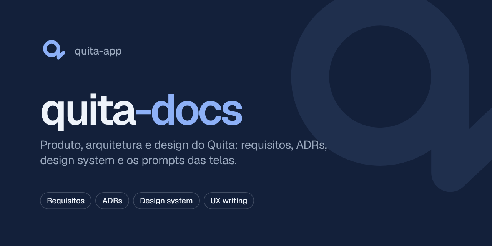
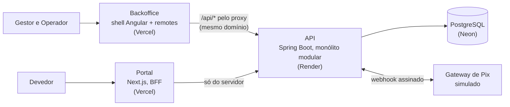

<p align="center">
  
</p>

<p align="center">
  <strong>Capítulo 1 · O porquê</strong><br />
  A documentação do Quita: o problema, as regras do negócio, a arquitetura e cada decisão, com o motivo.
</p>

<p align="center">
  
  
  
  
</p>

---

## O Quita em uma frase

Uma plataforma B2B de cobrança e renegociação: a **Credora** (uma escola, uma clínica) sobe a lista de quem deve e define até onde aceita negociar; o **Devedor** resolve sozinho pelo celular; o **Operador** cuida só das exceções; o **Gestor** vê quanto recuperou. O nome vem de **quitar**: pagar o que deve e ficar em dia.

## O problema

Credoras de médio porte (escolas particulares, clínicas, academias, varejo regional) cobram inadimplentes por planilha, e-mail e WhatsApp. Não há política clara de desconto, cada atendente negocia de um jeito, acordos quebram sem ninguém perceber e o gestor não sabe quanto recuperou. Do outro lado, quem deve sente vergonha, foge da ligação e não sabe quanto deve de verdade.

## A história que guia tudo

> A **Ana** deve R$ 1.000,00 de mensalidade para a escola, vencida há **120 dias**. A Política da escola, para a faixa de 91 a 180 dias de atraso, permite até **25% de desconto à vista** e até **10 parcelas**. Às 22h, a Ana recebe um SMS, entra com o CPF e um código, simula, escolhe **5 parcelas**, paga a entrada por **Pix**, e o Acordo fica ativo. Ninguém precisou ligar para ninguém.

Cada requisito, tela e teste do Quita existe para que essa história funcione, em menos de 3 minutos, no celular. O exemplo completo, com todos os números (inclusive o que acontece se a Ana atrasar uma Parcela), está nos [requisitos de negócio](docs/foundation/business-requirements.md).

## Os capítulos

O Quita é contado em quatro repositórios. Este é o primeiro: os outros três importam daqui o vocabulário e o desenho.

| Capítulo | Repositório | Para quem | O que resolve |
| --- | --- | --- | --- |
| **1 · O porquê** 📍 | **`quita-docs`** | Quem quer entender o produto | Problema, regras de negócio, arquitetura e decisões (você está aqui) |
| 2 · As regras | [`quita-backend-api`](https://github.com/quita-app/quita-backend-api) | Todos, por trás das telas | Regras, dados e integrações · Java, Spring Boot, PostgreSQL |
| 3 · O balcão da Credora | [`quita-backoffice-web`](https://github.com/quita-app/quita-backoffice-web) | Gestor e Operador | Importar, configurar a Política, trabalhar a Fila, acompanhar o Painel · Nx, Angular, React |
| 4 · A porta da Ana | [`quita-debtor-portal-web`](https://github.com/quita-app/quita-debtor-portal-web) | Devedor | Ver a Dívida, simular, fechar o Acordo, pagar por Pix · Next.js |

## A arquitetura em um desenho



O navegador só fala com domínios do próprio front; a API nunca é chamada direto de outro site. Os detalhes estão no [HLD](docs/hld.md).

## Por onde começar

Leia na ordem; cada documento parte do anterior.

1. [Product brief](docs/product-brief.md): o quê, para quem, o escopo do MVP e como medir o sucesso.
2. [Requisitos de negócio](docs/foundation/business-requirements.md): como a cobrança funciona, com o exemplo da Ana em números.
3. [Glossário](GLOSSARY.md): o vocabulário do domínio e o nome de cada termo no código.
4. [HLD](docs/hld.md): a arquitetura de alto nível, com diagramas.
5. [ADRs](docs/adr/): as decisões de arquitetura e as alternativas descartadas.
6. [LLDs](docs/lld/): o detalhe de cada frente (API, banco, backoffice, portal).
7. [Roadmap](docs/roadmap.md): as funcionalidades, na ordem em que são construídas.
8. [Design](design/DESIGN.md): o design system "Céu" e as telas aprovadas em `design/hi-fi/`.

## Como o Quita é construído

**Spec-driven development.** Nenhuma funcionalidade começa pelo código. Cada uma passa por:

```
PRD (o quê e os critérios de aceite) → spec (como) → tarefas (fatias verticais) → código → revisão
```

As decisões que mudam o desenho viram **ADR**, com o contexto, a escolha e o que foi descartado. O fluxo é apoiado por skills do Claude Code, em `.claude/skills/` (`product-brief`, `prd`, `to-spec`, `to-tasks`, `grilling`, `domain-modeling`).

**Walking skeleton primeiro.** A primeira funcionalidade (F01) publica todos os apps conversando de ponta a ponta, sem nenhuma regra de negócio: problema de integração aparece cedo, quando é barato.

## Estrutura

```
docs/
  foundation/        requisitos de negócio
  product-brief.md   produto, público e escopo
  hld.md             arquitetura de alto nível
  lld/               detalhe de cada frente: api, database, backoffice, portal
  adr/               decisões de arquitetura (0001 a 0013)
  features/          uma pasta por funcionalidade: prd.md, spec.md e tasks/
  roadmap.md         funcionalidades, ondas e datas
design/
  DESIGN.md          design system "Céu" (tokens, tipografia, componentes)
  ux-writing.md      textos de tela e mapa de erros
  hi-fi/             as 25 telas aprovadas do MVP, claro e escuro
  brand/             logo, símbolo, ícones e os banners dos repositórios
harness/             o kit de instruções de agente de cada repositório de código
GLOSSARY.md          o vocabulário do domínio
```

## Status

| Etapa | Situação |
| --- | --- |
| Produto, arquitetura (HLD + 13 ADRs), LLDs e design hi-fi | ✅ aprovados |
| Roadmap do MVP (F01 a F14) | ✅ rascunho |
| F01 · Walking skeleton | 🟡 em construção: API rodando localmente; backoffice e portal a seguir |
| F02 a F14 · MVP | ⬜ |

<p align="center"><sub>Quita · cobrança que baixa a tensão</sub></p>
