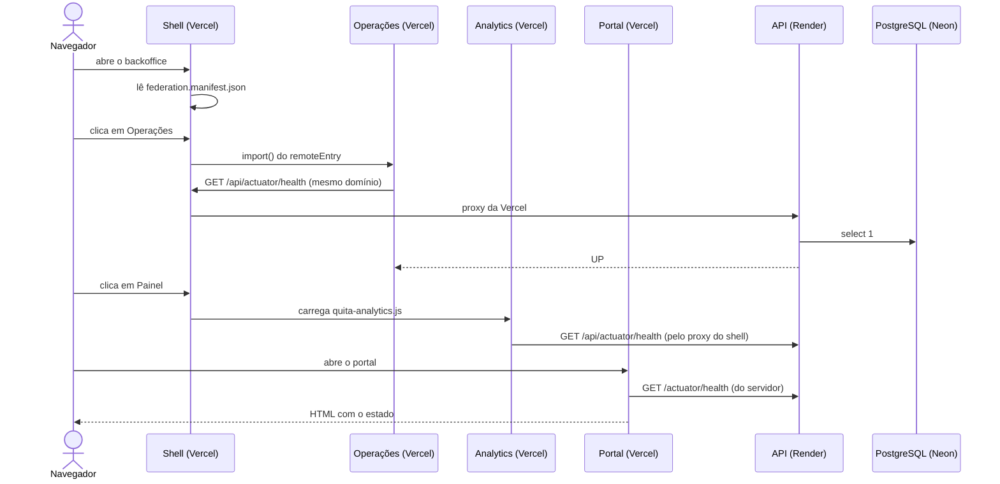

# Spec: F01 · Walking skeleton

2026-11-11 · helloWorldRuan · Status: rascunho · PRD: [prd.md](prd.md)

## Visão geral

Setas cheias são chamadas; tracejadas, respostas. O navegador só fala com domínios da Vercel.

## Contrato da API

| Rota | Quem chama | Resposta |
| --- | --- | --- |
| `GET /actuator/health` | Render (health check), fronts | `{ "status": "UP" }` com o componente `db`; 503 com `DOWN` se o banco cair |
| `GET /actuator/health/liveness`, `/readiness` | Contêiner, Render | Probes |

Nenhuma rota de negócio. Sem autenticação nesta funcionalidade: o Actuator expõe só `health` e `info`.

O `openapi.json` é gerado e versionado já nesta funcionalidade (vazio de rotas de negócio), para o passo de geração de tipos dos fronts existir desde o começo.

## Dados

- Migração `V<carimbo>__shared_create_schemas.sql`: um schema por módulo (`identity`, `portfolio`, `negotiation`, `payment`, `collection`, `notification`, `analytics`, `audit`, `fake_gateway`) e `create extension pg_trgm`.
- Nenhuma tabela de negócio.
- `compose.yaml` na raiz do `quita-backend-api`, com o PostgreSQL na mesma versão do Neon (o banco local de desenvolvimento).

## Decisões por repo

### quita-backend-api

- Projeto do Spring Initializr: Maven, Java 25, Spring Boot 4.x; dependências: Web, Data JPA, PostgreSQL, Flyway, Actuator, Validation, Security, OAuth2 Resource Server, Spring Modulith, Lombok, Testcontainers, springdoc.
- Configuração do LLD da API, seção 12, e do guia de estudo: virtual threads, `open-in-view` desligado, pool pequeno, desligamento gracioso, Actuator restrito.
- A segurança permite `GET /actuator/health/**` e nega o resto (nenhuma rota de negócio existe ainda).
- Pacotes vazios dos nove módulos, com `package-info.java`.
- Testes: `ModularityTests` e um teste de contexto com Testcontainers.
- Dockerfile multi-stage; CI com `verify`; deploy na `main` com migração antes e deploy hook do Render depois.

### quita-backoffice-web

- Workspace Nx com `apps/shell` e `apps/operations` (Angular, Native Federation, zoneless) e `apps/analytics` (React + Vite em modo biblioteca, um arquivo `quita-analytics.js`).
- As libs da seção 2 do LLD criadas vazias, com as tags; regra de fronteira ligada.
- Shell: menu com duas rotas; `/operations` por `loadRemoteModule`; `/analytics` por um componente hospedeiro que carrega o script e usa `CUSTOM_ELEMENTS_SCHEMA`; estado "área não carregou" com nova tentativa.
- Configuração por `InjectionToken` (`APP_CONFIG`, `REMOTES_MANIFEST`), lida na inicialização.
- `libs/shared/design-tokens` com os tokens do `design/DESIGN.md` como CSS custom properties, aplicados nos dois frameworks.
- O estado da API é lido por `fetch`/`HttpClient` em `/api/actuator/health`; o servidor de desenvolvimento e a Vercel fazem o proxy.
- Três projetos na Vercel; `vercel.json` do shell com o proxy `/api/*` e o manifesto sem cache.
- CI com `nx affected -t lint test build`.

### quita-debtor-portal-web

- Projeto do `create-next-app`: TypeScript, App Router, Tailwind, ESLint, `src/`.
- `src/lib/api/` com `server-only` e a função de health com timeout de 5 s.
- Página inicial como Server Component dinâmico, mostrando o estado da API.
- Tokens copiados de `libs/shared/design-tokens` (até a decisão de distribuição), fonte com `next/font`.
- Projeto na Vercel com `API_INTERNAL_URL` em Preview e Production; CI com lint, tipos, testes e build.

### quita-docs

- Os kits de `harness/` instalados em cada repo (`harness/install.sh`), com as versões fixadas preenchidas no `AGENTS.md` de cada um.

## Decisões de teste

- **API:** `ModularityTests` (fronteiras) e teste de contexto com PostgreSQL real; o health com banco caído é conferido à mão.
- **Backoffice:** um teste do componente hospedeiro (carrega o script uma vez só) e um do estado "área não carregou"; a federação é conferida à mão e no deploy.
- **Portal:** um teste da função de health (no ar, fora do ar, timeout) com MSW.
- **Sem ponta a ponta** nesta funcionalidade; o Playwright é configurado, mas o primeiro fluxo entra na F02.

## Fora de escopo

O mesmo do PRD.

## Decisões tomadas aqui

| Decisão | Alternativa descartada | Por quê |
| --- | --- | --- |
| Health check como única integração | Uma rota "hello" de negócio | O health já prova API + banco, e não cria código que será apagado |
| Analytics lê a API pelo proxy do shell | Analytics chamando a API direto | Mesmo domínio, mesmo cookie depois (ADR 0007) |
| Portal copia o CSS dos tokens no skeleton | Pacote publicado já agora | A forma de distribuição está em aberto; copiar é reversível |
| Flyway na subida só no perfil local | Flyway sempre na subida | Na demo, a migração é passo próprio do deploy (LLD do banco, seção 8) |

## Questões em aberto

As mesmas do PRD.
