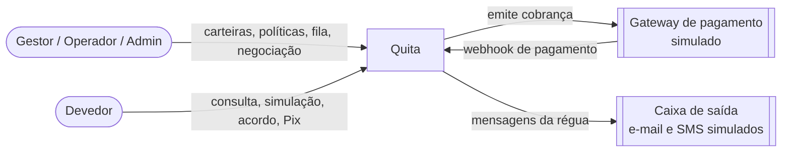
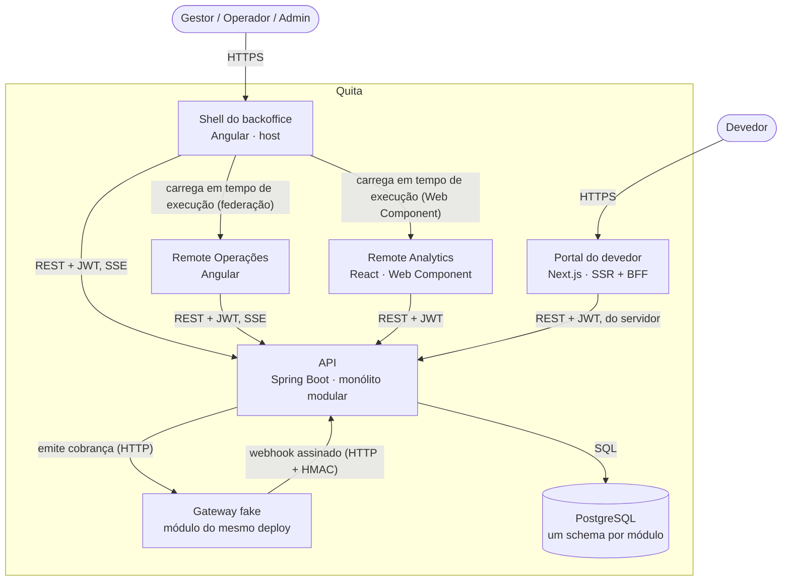
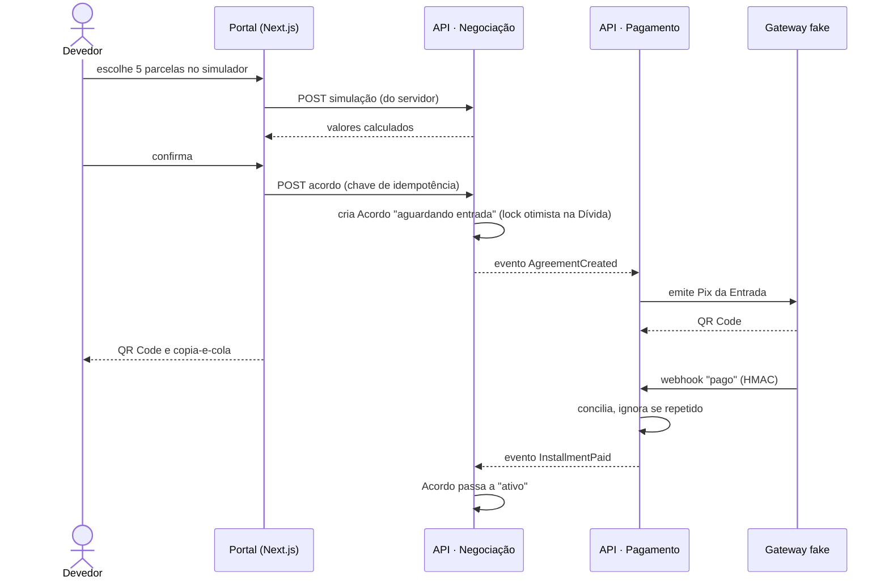
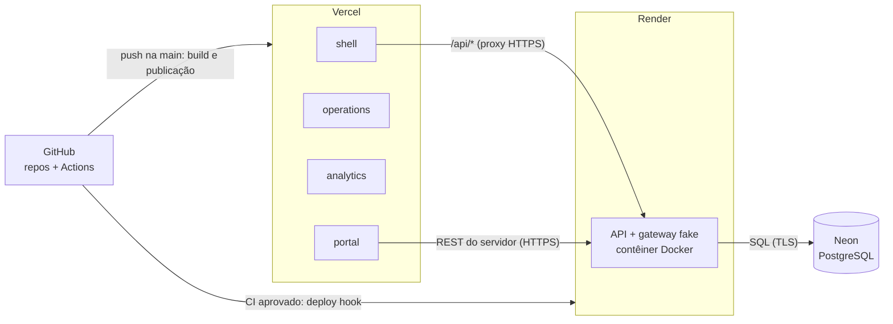

# HLD: Quita

2026-11-10 · helloWorldRuan · Status: aprovado

Arquitetura de alto nível: que partes existem, como conversam e por quê. O detalhe de implementação de cada frente fica em `docs/lld/`. O produto e o escopo estão em `docs/product-brief.md`; o vocabulário, em `GLOSSARY.md`.

## 1. Contexto e objetivos

O Quita liga três públicos com necessidades opostas: a Credora e o Operador, que passam o dia num sistema interno denso, e o Devedor, que chega uma vez pelo celular, sem conta e sem paciência. A arquitetura separa esses mundos sem duplicar as regras de negócio, que moram num lugar só.

**Objetivos de arquitetura**, em ordem de prioridade:

1. **Isolamento de tenant:** dado de uma Credora nunca chega a outra, nem por erro de programação.
2. **Correção do dinheiro e dos estados:** cálculo exato, transições de Acordo válidas, nenhum pagamento contado duas vezes.
3. **Publicação independente dos fronts:** portal, shell e cada remote publicam sozinhos.
4. **Custo de hospedagem zero:** tudo roda em camadas gratuitas.
5. **Fronteiras prontas para crescer:** os módulos do back podem virar serviços sem reescrever o domínio.

## 2. Restrições

| Restrição | Origem |
| --- | --- |
| Front em micro front-ends com Angular, React e Next.js | Imposta (brief, "Requisitos não funcionais") |
| Back em Java com Spring Boot, orientado a domínio | Imposta (brief) |
| Projeto completo em 8 semanas, uma pessoa, 4 h por dia | Imposta (brief) |
| Hospedagem em camadas gratuitas | Imposta (brief) |
| CDC (art. 42 e 43, multa de 2%) e LGPD | Legal (`business-requirements.md`, seção "Regras do mundo real") |
| Gateway de pagamento, e-mail e SMS simulados | Escopo (brief, "Fora de escopo") |

## 3. Requisitos de qualidade

| Atributo | Requisito | Como se prova |
| --- | --- | --- |
| Segurança | Nenhum dado cruza tenants | Teste automatizado que tenta ler dados de outra Credora em cada módulo |
| Correção | Pagamento repetido não dá baixa duas vezes | Teste que entrega o mesmo webhook 3 vezes |
| Desempenho | Listagens com p95 < 300 ms com 1 milhão de Dívidas | Teste de carga na Fase 3 |
| Desempenho | LCP do portal < 2,5 s em 4G | Lighthouse em modo mobile no CI |
| Acessibilidade | Portal WCAG 2.2 AA, nota 100 no Lighthouse | Lighthouse no CI + teste por teclado |
| Disponibilidade | API pode dormir na hospedagem gratuita; o usuário nunca vê erro por isso | Fronts tratam o "acordando" com espera e nova tentativa |
| Manutenção | Um módulo do back não acessa o interior de outro | Verificação de fronteiras do Spring Modulith nos testes |

## 4. Contexto do sistema

**Diagrama de contexto**

Pessoas em formas arredondadas; sistemas externos em caixas duplas. O gateway e a caixa de saída são simulados, mas tratados como externos: o Quita conversa com eles só pelas interfaces que um serviço real teria.

## 5. Arquitetura

**Diagrama de contêineres**

Retângulos são contêineres (apps ou serviços que rodam sozinhos); o cilindro é o banco. Cada seta diz o que trafega e o protocolo.

**Os contêineres**

| Contêiner | Responsabilidade | Repo |
| --- | --- | --- |
| Shell do backoffice | Layout, login, menu, sessão e rotas de primeiro nível; carrega os remotes | `quita-backoffice-web` |
| Remote Operações | Fila, ficha do Devedor, importação de Carteira, Política, admin | `quita-backoffice-web` |
| Remote Analytics | Painel de indicadores, exposto como Web Component | `quita-backoffice-web` |
| Portal do devedor | Acesso por CPF e código, Simulação, Acordo, Pix; renderiza no servidor e chama a API pelo servidor (BFF) | `quita-debtor-portal-web` |
| API | Todas as regras de negócio, dados e integrações | `quita-backend-api` |
| Gateway fake | Simula um provedor de Pix e boleto: emite cobranças e envia webhooks | `quita-backend-api` |
| PostgreSQL | Dados de todos os módulos | Neon |

**Módulos da API** (contextos do domínio, com as fronteiras verificadas):

- **Identidade:** Credoras, usuários, papéis, sessões, acesso do Devedor.
- **Carteira:** importação, Dívidas, Devedores, Faixa de atraso, Valor atualizado.
- **Negociação:** Política, Simulação, Proposta, Exceção, Acordo, Parcela, Quebra.
- **Pagamento:** Cobrança, Pagamento, Conciliação, webhook.
- **Atendimento:** Fila, Tratativa, Promessa de pagamento, Régua de cobrança.
- **Notificação:** caixa de saída simulada e notificações internas.
- **Analytics:** modelos de leitura do painel, alimentados por eventos.
- **Auditoria:** trilha de quem fez o quê.

Os módulos conversam por **eventos de domínio publicados dentro da aplicação**, com registro persistente de publicação (o padrão outbox do Spring Modulith). Uma chamada direta entre módulos só acontece pela interface pública do módulo chamado.

## 6. Fluxos principais

### 6.1 O Devedor fecha um Acordo e paga a Entrada

**Fluxo da Ana**

Setas cheias são chamadas; tracejadas, respostas ou eventos. Se o Operador fechar um Acordo para a mesma Dívida ao mesmo tempo, o lock otimista deixa só um vencer, e o outro recebe um conflito (detalhes no LLD da API).

### 6.2 O shell carrega um remote

1. O Gestor abre o backoffice; o shell sobe com layout, login e menu.
2. Ao entrar em Operações, o shell lê o manifesto do remote no endereço configurado e carrega o código só nessa hora.
3. As bibliotecas compartilhadas (Angular, RxJS) vêm do shell, uma vez só.
4. Para o Analytics, o shell carrega o script do Web Component e insere a tag; o React fica isolado dentro dele.
5. Se um remote não responde, o shell mostra um estado de erro só naquela área, e o resto do backoffice continua funcionando.

### 6.3 Importação de Carteira

O Gestor envia o arquivo; a API responde na hora com o id da importação e processa em segundo plano, em lotes. O progresso chega ao Operações por SSE. Uma linha inválida vai para o relatório de erros sem derrubar o lote.

### 6.4 Quebra de Acordo

Um job agendado diário encontra Parcelas em atraso além da tolerância, quebra os Acordos e publica `AgreementBreached`. Atendimento devolve a Dívida à Fila; Analytics atualiza os números.

## 7. Dados

- **Um banco PostgreSQL, um schema por módulo.** Cada módulo só escreve no próprio schema; outro módulo que precisa de um dado guarda o id e recebe o resto por evento ou pela interface pública. Isso mantém a extração de um serviço possível.
- **Multi-tenancy por coluna:** toda tabela de dado de Credora tem o id do tenant, e o filtro é aplicado pela camada de persistência, não à mão em cada consulta (ADR 0006).
- **Dinheiro** é guardado como decimal exato, nunca como ponto flutuante.
- **Analytics** lê modelos de leitura próprios, atualizados por eventos, com até 5 minutos de atraso.
- Schema, migrações e índices: LLD do banco.

## 8. Conceitos transversais

### Segurança e privacidade

- Autenticação própria da API (ADR 0004): token de acesso de vida curta, mantido só em memória no front, e token de renovação em cookie httpOnly.
- **Cookie sempre do mesmo site:** cada front chama a API pelo próprio domínio. O backoffice usa uma regra de proxy da Vercel (`/api/*` → API); o portal chama a API pelo servidor. Assim o cookie nunca é de terceiro, e os bloqueios de cookie de terceiros dos navegadores não afetam o login.
- Webhook autenticado por assinatura HMAC.
- CPF mascarado por padrão; dado sensível fora dos logs; trilha de auditoria para ações sensíveis.

### Observabilidade

- Um id de correlação nasce no front, viaja no cabeçalho de cada requisição e aparece em todos os logs da API.
- Logs estruturados em JSON; health check e métricas pelo Actuator.
- Sem ferramenta paga: os logs da hospedagem bastam no escopo do projeto.

### Erros, novas tentativas e idempotência

- Erros da API no formato Problem Details (RFC 9457), com um código próprio por regra de negócio.
- Criação de Acordo e processamento de webhook são idempotentes (chave de idempotência e deduplicação por id do evento).
- Concorrência por lock otimista; o conflito vira 409, e o front explica o que aconteceu.
- Os fronts tentam de novo com intervalo crescente quando a API está acordando, mostrando esse estado ao usuário.

### Configuração e segredos

Toda configuração vem de variáveis de ambiente de cada plataforma. Nenhum segredo no repositório; cada repo tem um `.env.example`.

### Tempo real

SSE para o que só vai do servidor ao navegador (progresso de importação, notificações, pagamento confirmado). WebSocket só no chat da Fase 3, que precisa dos dois sentidos.

### Design system

Os tokens visuais têm uma fonte só e chegam aos três fronts (Angular, React, Next.js) pelo mesmo pacote. Como o pacote é distribuído: a definir (ver Questões em aberto).

## 9. Implantação e ambientes

**Implantação**

Caixas agrupadas são plataformas; setas dizem o gatilho ou o protocolo.

| Ambiente | Para quê | Onde |
| --- | --- | --- |
| Local | Desenvolvimento | Banco e API no Docker Compose do `quita-docs`; fronts com o servidor de desenvolvimento de cada ferramenta |
| Prévia | Revisar um PR | Prévia automática da Vercel por PR; banco de prévia como branch do Neon: a definir |
| Demo (produção) | Portfólio público, dados fictícios | Vercel + Render + Neon |

## 10. Decisões

| ADR | Decisão |
| --- | --- |
| [0001](adr/0001-repository-structure.md) | Quatro repos: documentação, backoffice em monorepo Nx, portal e API |
| [0002](adr/0002-micro-frontend-composition.md) | Shell Angular com remotes por federação; Analytics como Web Component; portal separado |
| [0003](adr/0003-modular-monolith.md) | Back como monólito modular com eventos dentro da aplicação |
| [0004](adr/0004-own-authentication.md) | Autenticação própria com JWT curto e refresh em cookie httpOnly |
| [0005](adr/0005-rest-openapi-generated-clients.md) | REST com OpenAPI gerado do código (substituída em parte pela 0011) |
| [0006](adr/0006-tenant-discriminator-column.md) | Multi-tenancy por coluna num banco só |
| [0007](adr/0007-free-tier-hosting.md) | Vercel, Render e Neon nas camadas gratuitas, com proxy do mesmo site |
| [0008](adr/0008-no-cross-schema-foreign-keys.md) a [0012](adr/0012-native-federation-and-web-component.md) | Decisões dos LLDs (índice em cada LLD) |

Decisões que ficam só no texto: SSE no lugar de WebSocket (seção "Tempo real"); gateway fake no mesmo deploy da API (seção 5); portal como BFF (seção 5).

## 11. Riscos e dívida técnica

| Risco | Mitigação |
| --- | --- |
| API dorme e o primeiro acesso demora cerca de 1 minuto | Estado "acordando" com nova tentativa nos fronts; aviso na demo |
| Memória curta da hospedagem gratuita para a JVM | Ajuste de memória da JVM; medir no walking skeleton |
| Shell e remotes com versões incompatíveis das bibliotecas compartilhadas | Versões alinhadas no monorepo; o manifesto nunca fica em cache |
| Estilo do React dentro do shell Angular vazando ou faltando | Web Component com estilos encapsulados e os mesmos tokens |
| Camadas gratuitas mudarem de regra | Nada depende de recurso exclusivo de uma plataforma; trocar é configuração |
| Gateway fake no mesmo deploy esconder problemas de rede reais | O módulo só fala com a API por HTTP público e assinado, como um externo |

## 12. Questões em aberto

- [x] Variante de federação: Native Federation (ADR 0012).
- [ ] Como distribuir o pacote de tokens visuais entre os repos (pacote no GitHub Packages, ou outro).
- [ ] Banco de prévia por PR com branch do Neon: sim ou não.
- [ ] Domínio próprio para a demo (custo baixo, mas não zero).
- [ ] Pagamento depois da Quebra: crédito ou estorno (regra de negócio, LLD da API).
