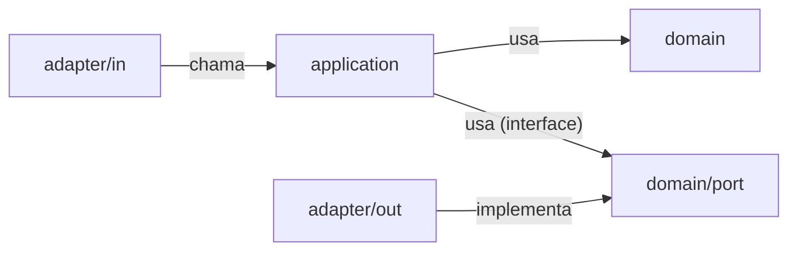
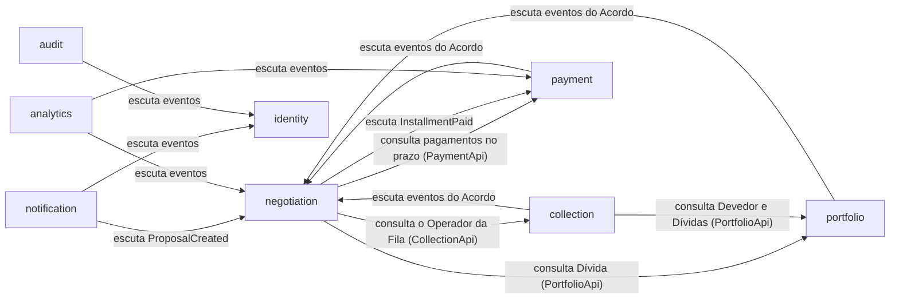
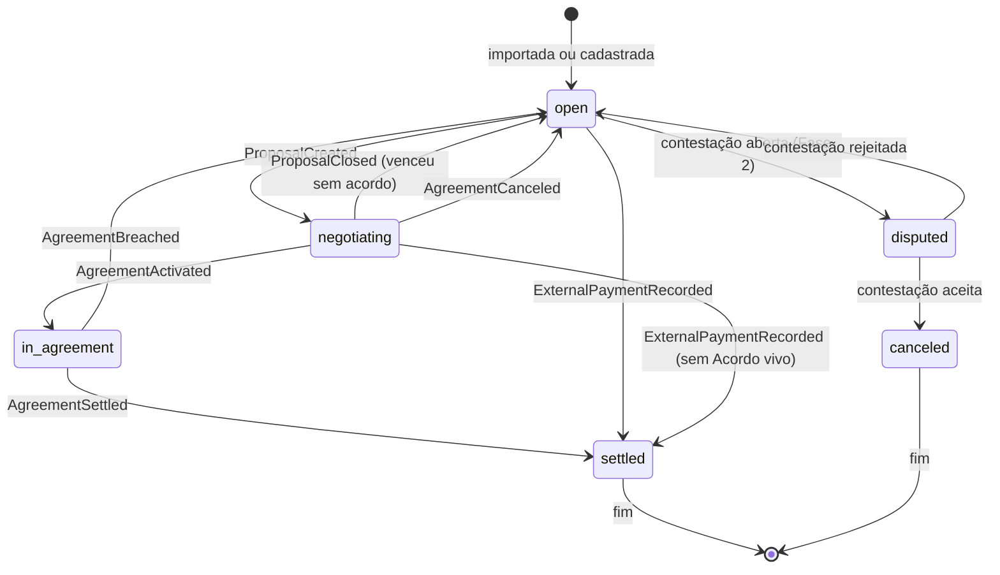
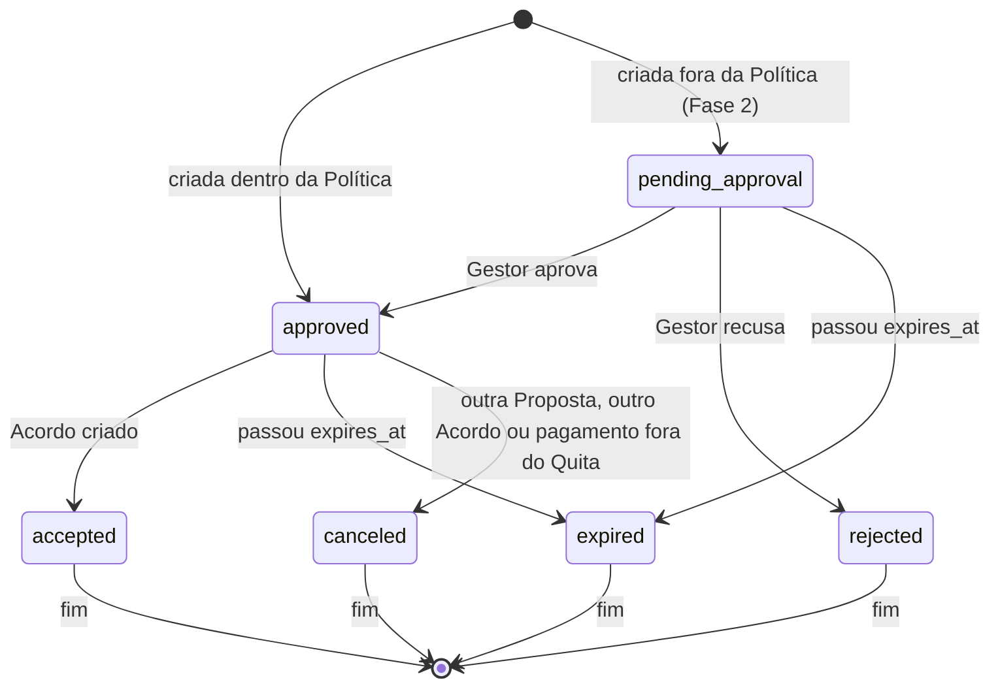
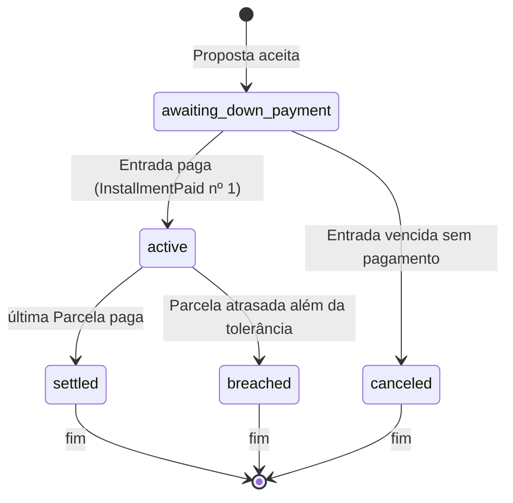

# LLD: API (`quita-backend-api`)

2026-11-10 · helloWorldRuan · Status: aprovado

Como a API funciona por dentro: estrutura dos módulos, regras de negócio com números, máquinas de estado, contrato REST, segurança, jobs e o gateway fake. As partes e como conversam estão no HLD; o banco, em `docs/lld/database.md`; o vocabulário, em `GLOSSARY.md`.

## Onde mora cada fato

| Fato | Dono |
| --- | --- |
| Rotas, corpos e respostas | O `openapi.json` gerado e versionado no `quita-backend-api` (ADR 0005), assim que existir. Até lá, o índice de rotas planejadas fica aqui. |
| Convenções de toda rota (formato, erros, paginação, idempotência) | Este documento, seção 7 |
| Valores de regra | Este documento, seção 6 ("Valores e configuração") |
| Forma das tabelas | `docs/lld/database.md` → migrações |
| Variáveis de ambiente | Este documento, seção 12, até existir o `.env.example` do repo |

## 1. Stack

| Peça | Escolha | Por quê |
| --- | --- | --- |
| Linguagem | Java 25 (LTS) | Versão LTS atual; records, pattern matching, virtual threads |
| Framework | Spring Boot, linha 4.x atual | Versão exata fixada no walking skeleton |
| Web | Spring Web MVC com virtual threads | ADR 0009 |
| Persistência | Spring Data JPA + Hibernate | `@TenantId`, lock otimista com `@Version`, UUID v7 nativo |
| Migrações | Flyway | `docs/lld/database.md`, seção "Migrações" |
| Módulos | Spring Modulith | Verificação de fronteiras, eventos com registro de publicação, testes por módulo |
| Segurança | Spring Security + OAuth2 Resource Server (validação de JWT) + `JwtEncoder` (emissão) | Sem biblioteca de JWT de terceiros |
| Senhas | Argon2id (`Argon2PasswordEncoder`) | Recomendação atual da OWASP |
| Contrato | springdoc-openapi | Gera o `openapi.json` do código |
| Validação | Bean Validation | Validação de entrada nos DTOs |
| Limite de taxa | Bucket4j, em memória | Uma instância só; sem Redis |
| Observabilidade | Actuator + Micrometer + logs JSON (encoder do Logback) | HLD, "Observabilidade" |
| Boilerplate | Lombok | Padrão de mercado; regras de uso abaixo |
| Mapeamento | MapStruct | Padrão de mercado para entidade ↔ DTO, gerado em tempo de compilação |
| Testes | JUnit 5, AssertJ, Mockito, Testcontainers (PostgreSQL), Spring Modulith Test, MockMvc | Seção 11 |
| Build | Maven, um módulo só | Os módulos de domínio são pacotes, verificados pelo Modulith |

**Regras de uso do Lombok** (o que um revisor de mercado cobra):

| Onde | Usar | Evitar, e por quê |
| --- | --- | --- |
| Entidades JPA (agregados) | `@Getter`, `@NoArgsConstructor(access = PROTECTED)` | `@Data`, `@Setter`, `@EqualsAndHashCode`, `@ToString` sem exclusões: setters furam as regras do agregado, e `equals`/`toString` gerados disparam carregamento preguiçoso e laços em relações JPA |
| Serviços, casos de uso, controllers, adapters | `@RequiredArgsConstructor` (injeção por construtor com campos `final`), `@Slf4j` | `@Autowired` em campo |
| Value objects e objetos de teste | `@Builder`, `@Value` quando não for `record` | `@Builder` em entidade JPA |
| DTOs de entrada e saída | `record` do Java | Lombok, porque o `record` já resolve |

## 2. Arquitetura interna: hexagonal por módulo

Cada módulo segue **Ports and Adapters** (arquitetura hexagonal), de forma pragmática (ADR 0010):

- **Domínio no centro:** agregados, value objects e regras, sem depender de web, de mensageria nem de outro módulo.
- **Casos de uso** (camada de aplicação): uma classe por caso de uso (`CreateAgreementUseCase`), com um método `execute`. Ela abre a transação, carrega o agregado, chama o domínio e salva.
- **Portas de saída:** interfaces que o domínio e os casos de uso precisam do mundo de fora (`AgreementRepository`, `PaymentGatewayPort`, `DebtLookupPort`). Ficam no núcleo.
- **Adapters:** a implementação de cada porta. De entrada: controllers REST, ouvintes de eventos, jobs. De saída: persistência JPA, cliente HTTP do gateway, chamada à interface pública de outro módulo.
- **Concessão pragmática:** as entidades de domínio levam as anotações do JPA, em vez de existir um modelo de persistência separado. Isso evita duplicar cada classe, e o domínio continua sem setters e com as regras dentro dele.

**Estrutura de pacotes**

Cada pacote de primeiro nível abaixo de `com.quita` é um módulo do Spring Modulith. Só o que fica no pacote raiz do módulo e nos pacotes marcados como interface nomeada é visível para os outros.

```
com.quita
  QuitaApplication.java
  shared/                       ← núcleo compartilhado (sem regra de negócio)
    money/                        Money, Rate, Rounding
    tenant/                       TenantContext, TenantId
    web/                          Problem Details, cursor de paginação, idempotência
    time/                         Clock da aplicação (fuso de São Paulo)
  negotiation/
    NegotiationApi.java         ← porta pública do módulo para os outros módulos
    events/                     ← eventos publicados (interface nomeada)
    internal/
      domain/
        model/                    Agreement, Installment, Proposal, NegotiationPolicy (agregados e VOs)
        service/                  SimulationCalculator, DiscountCalculator (regras sem estado)
        port/                     AgreementRepository, DebtLookupPort (portas de saída)
      application/
        usecase/                  SimulateNegotiationUseCase, CreateAgreementUseCase, BreachOverdueAgreementsUseCase
        command/                  CreateAgreementCommand (entrada dos casos de uso)
      adapter/
        in/web/                   AgreementController, DTOs (records), mappers MapStruct
        in/event/                 InstallmentPaidListener
        in/scheduler/             BreachJob
        out/persistence/          JpaAgreementRepositoryAdapter + AgreementJpaRepository (Spring Data)
        out/portfolio/            DebtLookupAdapter (chama a PortfolioApi)
  identity/  portfolio/  payment/  collection/
  notification/  analytics/  audit/  fakegateway/
                                ← mesma forma interna
```

**Regras de dependência dentro de um módulo**



As setas só apontam para dentro: o domínio não conhece ninguém; os adapters conhecem o núcleo, nunca o contrário. Verificado por teste de arquitetura (ArchUnit) junto com a verificação do Modulith.

**Padrões de projeto e onde aparecem**

| Padrão | Onde | Para quê |
| --- | --- | --- |
| Strategy | `CorrectionStrategy` (correção da Dívida), `QueuePriorityStrategy` (Fila) | Trocar o algoritmo por Credora sem `if` espalhado |
| Factory | `CorrectionStrategyFactory` (escolhe a estratégia pelo tipo de Credora), `ChargeFactory` (Pix no MVP; boleto depois) | Centralizar a criação do objeto certo |
| Observer | Eventos de domínio entre módulos | Um módulo reage sem o outro saber que ele existe |
| State | Transições do Acordo, da Proposta e da Dívida como métodos do agregado | Recusar transição inválida num lugar só |
| Adapter | `PaymentGatewayPort` → cliente HTTP do gateway fake | Trocar o gateway fake por um real mudando só o adapter |
| Repository | Portas de persistência | O domínio não conhece JPA |
| Specification | Filtros combináveis da busca de Dívidas e Devedores (`Specification` do Spring Data) | Montar consultas dinâmicas sem concatenar SQL |
| Builder | Value objects e dados de teste (Lombok `@Builder`) | Criar objetos complexos legíveis nos testes |
| Value Object | `Money`, `Rate`, `Document` (CPF/CNPJ), `TenantId` | Validar uma vez e nunca circular dado inválido |

**Dependências permitidas entre módulos**



Seta: "depende de", com o tipo de dependência. Todos os módulos dependem de `shared` e de `identity` (contexto de tenant e usuário), omitidos no diagrama. Ciclos são proibidos e verificados pelo Modulith: quando dois módulos precisam conversar nos dois sentidos, um dos sentidos é por evento. `fakegateway` não depende de ninguém e só fala com a API por HTTP.

## 3. Módulos

| Módulo | Agregados | Publica | Escuta |
| --- | --- | --- | --- |
| `identity` | Creditor (com o logo), AppUser, RefreshToken, PasswordReset, DebtorAccessCode | `UserInvited`, `PasswordResetRequested`, `AccessCodeRequested` | – |
| `portfolio` | PortfolioImport, Debtor, Debt | `PortfolioImportProgressed`, `PortfolioImportFinished`, `DebtImported` | `ProposalCreated`, `ProposalClosed`, `AgreementActivated`, `AgreementSettled`, `AgreementBreached`, `AgreementCanceled`, `ExternalPaymentRecorded` |
| `negotiation` | NegotiationPolicy, Proposal, Agreement (com Installments) | `ProposalCreated`, `ProposalClosed`, `AgreementCreated`, `AgreementActivated`, `AgreementSettled`, `AgreementBreached`, `AgreementCanceled`, `ExternalPaymentRecorded` | `InstallmentPaid` |
| `payment` | Charge, Payment, WebhookEvent | `ChargeIssued`, `InstallmentPaid` | `AgreementCreated`, `AgreementBreached`, `AgreementCanceled` |
| `collection` | WorkQueueItem, DebtorLock, Interaction | – | `DebtImported`, `AgreementActivated`, `AgreementBreached`, `ExternalPaymentRecorded` |
| `notification` | OutboxMessage | – | `AccessCodeRequested`, `UserInvited`, `PasswordResetRequested`, `ChargeIssued`, `ProposalCreated` (só as do backoffice) |
| `analytics` | modelos de leitura | – | `AgreementCreated`, `AgreementActivated`, `AgreementBreached`, `AgreementSettled`, `InstallmentPaid`, `DebtImported` |
| `audit` (Fase 2) | AuditEntry | – | eventos sensíveis de todos os módulos |
| `fakegateway` | FakeCharge | – (webhook HTTP) | – |

- Os textos das mensagens da caixa de saída estão em `design/ux-writing.md`, seção 8.
- **Eventos são records imutáveis**, com o `tenantId`, o id do agregado, o instante e só os dados que quem escuta precisa.
- **Quem escuta roda depois do commit de quem publicou** (`@ApplicationModuleListener`), numa transação própria. Se falhar, o registro de publicação do Modulith guarda o evento como não processado, e ele é reprocessado na próxima subida ou por um job.
- **Consequência:** entre módulos, a consistência é **eventual**. Exemplo: o Acordo fica `active` antes de a Dívida virar `in_agreement`, por alguns milissegundos.

## 4. Máquinas de estado

**Dívida (`Debt`)**



`negotiating` quer dizer: a Dívida tem uma Proposta aberta ou um Acordo `awaiting_down_payment`.

**Proposta (`Proposal`)**



Dois canais, uma regra (seção 5.4):
- **Portal:** o Devedor cria e aceita na mesma ação. A Proposta nasce `approved` e passa a `accepted` na mesma transação que cria o Acordo.
- **Backoffice:** o Operador envia a Proposta (`approved`, `channel = backoffice`); ela fica aberta até a Ana aceitar no portal, vencer ou ser encerrada (`canceled`).

**Acordo (`Agreement`)**



Cada transição é um método do agregado (`agreement.activate(...)`, `agreement.breach(...)`) que recusa a transição inválida com uma exceção de domínio. Nenhum código fora do agregado muda o `status` direto.

**Importação (`PortfolioImport`):** `processing → completed | completed_with_errors | failed`.

**Cobrança (`Charge`):** `pending → paid | expired | canceled`.

## 5. Regras de negócio

Cada regra está escrita para virar teste: condição, resultado e borda. Os valores citados pelo nome estão na seção 6.

### 5.1 Dinheiro

- Todo cálculo usa `BigDecimal` através do value object `Money`, com escala intermediária de 10 casas e arredondamento `HALF_EVEN` (o "arredondamento do banqueiro", que não puxa para cima em média). O resultado final fica com 2 casas.
- `Money` nunca é negativo e nunca soma moedas diferentes (só BRL).

### 5.2 Valor atualizado

Calculado na data de referência (hoje, no fuso de São Paulo):

- `dias de atraso = data de referência − original_due_date` (0 se ainda não venceu).
- `base = principal_amount − amount_paid`.
- `multa = base × LATE_FEE_RATE`, só se dias de atraso > 0.
- `juros = base × MONTHLY_INTEREST_RATE × dias de atraso ÷ 30` (juros simples, pró-rata dia).
- `correção = estratégia de correção da Credora` (Strategy):
  - `NoCorrectionStrategy`: zero. Padrão das Credoras do tipo escola.
  - `FixedIndexCorrectionStrategy`: `base × SIMULATED_MONTHLY_INDEX × dias ÷ 30`.
- `valor atualizado = base + multa + juros + correção`.

**Exemplo de teste** (a Ana): principal 1.000,00, nada pago, 120 dias, escola → multa 20,00, juros 40,00, correção 0 → **1.060,00**.

### 5.3 Simulação

Entradas: a Dívida, o número de Parcelas `n` (1 = à vista) e, opcionalmente, o valor de Entrada desejado.

1. A Faixa de atraso escolhe a `policy_bucket_rule` da Política publicada (seção 5.10). Sem Política publicada, a simulação é recusada com `NO_PUBLISHED_POLICY`, e o portal não oferece acordo.
2. `n` precisa estar entre 1 e `max_installments`; fora disso, erro `INSTALLMENTS_OUT_OF_POLICY`.
3. `desconto aplicado = max_discount_rate × (max_installments − n + 1) ÷ max_installments`.
4. `valor negociado = valor atualizado × (1 − desconto aplicado)`.
5. `Entrada = max(valor negociado × min_down_payment_rate, Entrada desejada)`. À vista, a Entrada é o valor inteiro.
6. `restante = valor negociado − Entrada`, dividido em `n − 1` Parcelas iguais, truncadas em 2 casas; o resíduo vai para a última.
7. Cada Parcela (exceto a Entrada) precisa ser ≥ `min_installment_amount`; se não for, o `n` máximo permitido é recalculado e devolvido como `maxInstallmentsAllowed`, junto com o erro `INSTALLMENT_BELOW_MINIMUM`.

**Exemplo de teste:** 1.060,00, faixa 91–180 (25%, 10 parcelas, 15%), `n = 5` → desconto 15%, negociado 901,00, Entrada 135,15, Parcelas 191,46 + 191,46 + 191,46 + 191,47.

A simulação não grava nada e pode ser chamada quantas vezes for preciso.

### 5.4 Proposta e Acordo

- **Uma Dívida por Acordo** no MVP: cada Proposta e cada Acordo apontam para uma Dívida só. Um Devedor com duas Dívidas fecha dois Acordos. Juntar várias Dívidas num Acordo é questão da Fase 2 (seção 14).
- A Proposta guarda os valores calculados no momento (`updated_amount`, `negotiated_amount`, `down_payment_amount`) e vale até `expires_at = agora + proposal_validity_hours` da Política.
- **O Operador nunca cria Acordo direto.** Na ficha (B06), "Enviar proposta à Ana" (`POST /proposals`) cria uma Proposta `approved`, com `channel = backoffice` e `created_by_user_id`. O `ProposalCreated` faz o `notification` mandar à Ana, por e-mail e SMS, o link `/c/<slug>/proposals/<id>`. Ela entra com o código, vê a Proposta na P07 ("Proposta enviada por Bruno, válida até 14/11") e aceita com "Li e concordo" (`POST /debtor/proposals/{id}/accept`). O aceite dela é a prova do Acordo.
- **Uma Proposta aberta por Dívida** (índice único parcial, `docs/lld/database.md`, 5.3). Enviar uma Proposta nova encerra a anterior (`canceled`) na mesma transação. Com Acordo vivo, `POST /proposals` devolve 409 `AGREEMENT_ALREADY_EXISTS`.
- **A Ana pode ignorar a Proposta** e fechar outra condição sozinha no portal (`POST /debtor/agreements`): o primeiro Acordo vale, e a Proposta aberta é encerrada (`canceled`) na mesma transação que cria o Acordo.
- **`ProposalClosed`** só é publicado quando a Proposta vence sem nada no lugar (a Dívida volta a `open`). Quando ela é encerrada por outra Proposta, por um Acordo ou por pagamento fora do Quita, o evento do que veio no lugar já leva a Dívida ao estado certo.
- **Criar o Acordo** (uma transação; o mesmo caso de uso nos dois canais):
  1. Recalcula a simulação **na data de referência da Proposta** (o dia em que ela foi criada) e confere se bate com ela. Protege contra mudança de Política entre a simulação e o aceite; os juros que correm durante a validade não invalidam a Proposta.
  2. Confere, pela `PortfolioApi`, se a Dívida está `open` ou `negotiating`.
  3. Encerra outra Proposta aberta da Dívida, se houver (`canceled`).
  4. Cria o Acordo `awaiting_down_payment` e as Parcelas, com o `operator_id` atribuído (seção 5.12).
  5. Exige o cabeçalho `Idempotency-Key`: a mesma chave devolve o mesmo Acordo, sem criar outro.
  6. Dois Acordos vivos para a mesma Dívida batem no índice único parcial; a API devolve 409 `AGREEMENT_ALREADY_EXISTS` (`docs/lld/database.md`, seção 5.3).
- **Uma trava por Dívida:** enviar Proposta, criar Acordo (nos dois canais) e registrar pagamento fora do Quita pegam, no começo da transação, a mesma trava da Dívida no PostgreSQL (`pg_advisory_xact_lock` com o id da Dívida). Assim essas ações nunca se cruzam para a mesma Dívida; a trava some sozinha no fim da transação.
- **Aceitar uma Proposta que não está aberta** (vencida ou encerrada) → 409 `PROPOSAL_EXPIRED`. Se a Dívida já tem Acordo vivo, a resposta é `AGREEMENT_ALREADY_EXISTS`.
- **Onde a Proposta aberta aparece:** `GET /debtor/debts` e `GET /debtors/{id}` trazem, em cada Dívida, a Proposta aberta (`openProposal`: id, valores, `expiresAt`, quem enviou). A P04 mostra no card; a B05, na Dívida.
- **Vencimentos:** a Entrada vence em `DOWN_PAYMENT_DUE_DAYS` dias; a Parcela `k` vence `k − 1` meses depois da Entrada, no mesmo dia do mês, ou no último dia do mês quando ele não existe (31/01 → 28/02).

### 5.5 Pagamento e conciliação

- **Webhook:** `POST /api/v1/webhooks/payment-gateway`, sem JWT, autenticado por HMAC-SHA256 do corpo cru com `GATEWAY_WEBHOOK_SECRET`, no cabeçalho `X-Gateway-Signature: t=<epoch>,v1=<hex>`. A assinatura cobre `t` + corpo.
  - Assinatura inválida → 401, e o evento é gravado com `signature_valid = false`.
  - `t` mais velho que `WEBHOOK_MAX_AGE` → 401 (proteção contra replay).
  - `gateway_event_id` repetido → 200 sem efeito (idempotência pelo banco).
  - Resposta rápida: grava o evento cru, responde 200 e processa em seguida.
- **Conciliação:** Cobrança `pending` e valor pago igual ao dela → Pagamento `reconciled`, Cobrança `paid`, evento `InstallmentPaid`. Valor diferente (incompleto ou a mais), ou Cobrança que não está mais `pending` (vencida ou cancelada, por exemplo depois de uma Quebra) → Pagamento `unreconciled`, para o Gestor resolver na B11. O motivo que a B11 mostra vem dos dados: sem Cobrança, "Cobrança não encontrada"; valor diferente, "Valor diferente da parcela"; Cobrança encerrada, "Cobrança encerrada".
- **Pagamento sem Cobrança:** o tenant vem da `external_reference` que o gateway devolve (a API a envia ao criar a Cobrança, com o tenant e o id da Cobrança). Sem nenhuma referência reconhecível, o Pagamento fica `unreconciled` sem tenant e vai para a fila do **admin da plataforma**, não da Credora.
- **Quem cria a Cobrança:** a Cobrança da Entrada nasce com o Acordo, pelo evento `AgreementCreated`. A rota `POST /debtor/installments/{id}/charges` gera a Cobrança sob demanda: um Pix novo quando o anterior venceu (P08, estado 5) e o Pix das Parcelas seguintes (P09).
- **Expiração:** o Pix vale até `PIX_EXPIRATION_HOURS` depois de emitido **ou** até o fim do último dia de pagamento da Parcela (23:59:59, fuso de São Paulo), o que vier primeiro. Último dia de pagamento: o vencimento, para a Entrada; o vencimento + `breach_tolerance_days`, para as outras Parcelas. Pedir de novo o Pix de uma Parcela com Cobrança vencida cria uma Cobrança nova; depois do último dia de pagamento, a rota devolve 409 `PAYMENT_WINDOW_CLOSED`.
- **Acordo encerrado:** ao receber `AgreementBreached` ou `AgreementCanceled`, o `payment` cancela as Cobranças `pending` daquele Acordo. Um pagamento que ainda chegue para elas cai na B11 ("Cobrança encerrada").
- **Pagamento depois da Quebra:** não vira crédito nem estorno no MVP. Vai para a B11, e o Gestor resolve à mão (`POST /payments/{id}/resolve`, com nota).

### 5.6 Quebra

**Regra de ouro: uma Quebra nunca é desfeita.** A Ana nunca vê "acordo cancelado" para depois ver o acordo voltar.

- O job de Quebra roda todo dia às `BREACH_JOB_CRON` (03:00), 3 horas depois do fim do último dia de pagamento. Como o Pix já venceu às 23:59:59 (seção 5.5), um pagamento feito no prazo teve tempo de chegar.
- Procura Parcelas `pending` com `due_date + breach_tolerance_days < hoje`.
- **Antes de quebrar, confere pela `PaymentApi`** se há, para aquela Parcela: um Pagamento `reconciled` com `paid_at` até o fim do último dia de pagamento (o `InstallmentPaid` ainda não foi processado), ou um `webhook_event` recebido e ainda não processado para uma Cobrança dela. Se houver, a Parcela fica de fora hoje e é vista de novo na próxima passada. Para a Ana, nesse meio-tempo, vale "pagamento em processamento".
- Pagamento dentro da tolerância, mas **menor** que a Parcela, é incompleto: fica `unreconciled` (B11), a Parcela continua `pending`, e o Acordo quebra normalmente.
- Para cada Parcela que quebra: o Acordo vira `breached`, as Parcelas `pending` viram `canceled`, e o evento `AgreementBreached` leva o total pago.
- A Carteira soma esse total em `amount_paid` da Dívida e a devolve a `open`. O desconto do Acordo quebrado se perde: o novo Valor atualizado é calculado sobre o principal menos o que já foi pago.
- **Entrada vencida** segue a mesma regra, no mesmo horário: Acordo `awaiting_down_payment` com a Entrada vencida (vencimento < hoje) e sem pagamento no prazo vira `canceled`.
- Pagamento que chega depois da Quebra: B11, sem crédito nem estorno (seção 5.5).

### 5.7 Acesso do Devedor

- `POST /api/v1/debtor/access-codes` com CPF/CNPJ e o slug da Credora. A resposta é **sempre a mesma**, exista ou não o Devedor, para não revelar quem deve (proteção contra enumeração).
- O código tem `ACCESS_CODE_LENGTH` dígitos, vale `ACCESS_CODE_TTL` e aceita `ACCESS_CODE_MAX_ATTEMPTS` tentativas; depois, bloqueio por `ACCESS_CODE_LOCK_DURATION`.
- Pedido de código limitado a `ACCESS_CODE_REQUESTS_PER_WINDOW` por documento a cada `ACCESS_CODE_REQUEST_WINDOW`.
- O código vai para a caixa de saída simulada (`notification.outbox_message`), e a demo mostra essa caixa (rota `/demo/inbox` do portal, só no ambiente de demonstração).
- **Uma Credora por sessão:** o Devedor é um registro por Credora (`debtor` é único por Credora e documento). A sessão nasce para a Credora do slug, e o token leva o `tid` dela; ele só enxerga as Dívidas daquela Credora. Para ver outra Credora, o Devedor entra pelo link dela, com outro código. Uma visão única de várias Credoras ("Meu Quita") é questão para depois do MVP (seção 14).

### 5.8 Fila e reserva

- **Prioridade (Strategy `QueuePriorityStrategy`):**
  - `OldestFirstStrategy` (padrão do MVP): maior atraso primeiro.
  - `HighestAmountStrategy`: maior Valor atualizado primeiro.
  - Promessa de pagamento vencida põe o Devedor no topo, em qualquer estratégia.
- **Distribuição:** rodízio entre os Operadores ativos ao entrar na Fila.
- **Reserva:** abrir a ficha reserva o Devedor por `DEBTOR_LOCK_DURATION`; o front renova a cada `DEBTOR_LOCK_HEARTBEAT` enquanto a ficha está aberta. Outro Operador recebe 409 `DEBTOR_LOCKED`, com o nome de quem está atendendo.
- **Reserva vencida:** não há job nem evento. A linha com `locked_until` no passado é sobrescrita na próxima tentativa de reservar (`docs/lld/database.md`, 5.5). Quem abre uma ficha reservada vê quem está atendendo e até quando (`lockedBy`, `lockedUntil`) e pode tentar de novo depois.
- Devedor com Acordo `active` sai da Fila; com Acordo quebrado, volta. Pagamento fora do Quita (`ExternalPaymentRecorded`) também tira o Devedor da Fila.
- **CPF para o Operador:** sempre mascarado no MVP. Ver o CPF completo depende de uma permissão que chega com a auditoria (F17).

### 5.9 Importação

- **Formato do MVP (modelo fixo, sem mapeamento):** CSV com separador `;`, decimal com vírgula, data `dd/mm/aaaa`. O cabeçalho é em português, porque o arquivo é do Gestor; a API traduz cada coluna para o campo interno:

| Coluna do modelo | Obrigatória | Formato | Campo interno |
| --- | --- | --- | --- |
| `CPF/CNPJ` | sim | com ou sem pontuação | `document` |
| `Nome` | sim | texto | `name` |
| `E-mail` | uma das duas | e-mail | `email` |
| `Celular` | uma das duas | com DDD | `phone` |
| `Contrato` | sim | texto | `contract_number` |
| `Descrição` | não | ex.: "Mensalidade de agosto" | `description` |
| `Valor original` | sim | `1.000,00` ou `1000,00` | `principal_amount` |
| `Vencimento` | sim | `dd/mm/aaaa` | `original_due_date` |

- **Cabeçalho tolerante:** compara sem acento, sem diferença de maiúscula e sem espaço extra. Aceita só os nomes do modelo e uma lista curta de sinônimos (`CPF`, `CNPJ` e `Documento` para `CPF/CNPJ`). Coluna obrigatória que não casa → `IMPORT_FILE_INVALID` com `missingColumns`.
- **Codificação:** aceita UTF-8 (com ou sem BOM). Se o arquivo não for UTF-8 válido, lê como Windows-1252, que é o "CSV" que o Excel em pt-BR salva.
- **Modelo para baixar:** um `.csv` com o cabeçalho e uma linha de exemplo (a Ana). O envio é sempre CSV no MVP.
- Limites: `IMPORT_MAX_ROWS` linhas e `IMPORT_MAX_FILE_SIZE`.
- `POST` responde 202 com o id; o processamento roda em segundo plano, em lotes de `IMPORT_CHUNK_SIZE` linhas, **uma transação por lote**. Um lote com erro de banco falha sozinho, sem desfazer os anteriores.
- **Validação por linha** (um só código de validação no `portfolio`, usado também pelo cadastro manual): CPF/CNPJ pelo dígito verificador; nome preenchido; **e-mail ou celular** preenchido (sem contato, o Devedor nunca recebe o código); valor > 0; data válida e no passado. Linha inválida → `import_row_error`, com **todas** as falhas da linha de uma vez (uma linha de erro por falha, com o mesmo `row_number`).
- **Arquivo errado de verdade para cedo:** se mais de `IMPORT_EARLY_FAIL_RATE` das linhas do primeiro lote tiverem erro, a importação para como `failed`, com `failure_reason = 'early_fail_rate'`, em vez de gerar milhares de erros iguais. A tela explica o provável motivo (colunas em outra ordem).
- **Relatório de erros** (`GET /portfolio-imports/{id}/errors.csv`): as **linhas originais** com erro, no mesmo formato do modelo, mais uma coluna `Erro` no fim com as falhas da linha. O Gestor corrige no próprio arquivo e o envia de novo; as linhas certas já entraram, e a duplicidade garante que nada é criado duas vezes.
- **Duplicidade:** mesma Credora + documento + contrato atualiza a Dívida, a menos que ela tenha Acordo vivo; nesse caso, a linha é contada como ignorada (`docs/foundation/business-requirements.md`, RN2.2 e RN2.3). Dívida quitada ou cancelada também não é sobrescrita (linha ignorada, RN2.3): uma Dívida paga fora do Quita não reabre se vier de novo no arquivo.
- **Origem da Dívida:** `debt.portfolio_import_id` é a importação que **criou** a Dívida e nunca muda; reimportar atualiza os dados, não a origem (RN2.8). A safra da F21 é o mês de `debt.created_at`.
- **Devedor reimportado:** o Devedor é atualizado com os dados mais recentes **não vazios**. Uma célula vazia não apaga o que já existe.
- **A importação não cancela nada:** uma Dívida que sumiu do arquivo do mês continua aberta. Quem dá baixa numa Dívida paga fora do Quita é o Gestor, na ficha (seção 5.15).
- **Validação no navegador:** a B07 valida o arquivo inteiro antes de enviar, com as mesmas regras de formato (`docs/lld/backoffice.md`, seção 6). A API continua sendo a fonte da verdade: duplicidade e Acordo vivo só ela sabe.
- Progresso publicado a cada lote (`PortfolioImportProgressed`) e entregue por SSE.
- **Cadastro manual de Dívida:** `POST /debts` com os campos de uma linha do modelo (nomes internos, em JSON). Usa a mesma validação da importação e a mesma regra de duplicidade; cria o Devedor pelo documento ou reaproveita o que já existe (com a regra do Devedor reimportado). Erros de validação → `VALIDATION_FAILED`, com `errors[]` por campo.

### 5.10 Faixas da Política

- Cada Política tem **de 1 a 5 Faixas de atraso** (`policy_bucket_rule`). A primeira Política da Credora começa com as 5 Faixas padrão: 0–30, 31–90, 91–180, 181–360 e mais de 360 dias.
- O Gestor edita os limites e os valores de cada Faixa, acrescenta (até 5) e remove (até sobrar 1).
- Regras, validadas no rascunho e na publicação: a primeira começa em 0; as Faixas não se sobrepõem nem deixam buraco; só a última não tem teto (`max_overdue_days` nulo). Falha → `VALIDATION_FAILED`, com `errors[]` por Faixa.
- **Quem lê as Faixas:** a Faixa de atraso de uma Dívida é sempre calculada com as Faixas da Política publicada da Credora. Os filtros da Fila, da Busca e do painel e o aging (`analytics.portfolio_aging`) usam essas Faixas, não uma lista fixa. Antes da primeira publicação, valem as 5 Faixas padrão.

### 5.11 Marca da Credora

- **No MVP, quem cadastra é o admin da plataforma**, no cadastro da Credora (B13): nome de exibição, logo (opcional), cor de assinatura (opcional), e-mail e telefone de atendimento. O editor do próprio Gestor, com pré-visualização ao vivo, é da F18.
- **Cor:** a Credora informa só a cor do tema claro (`brand_color`, hex). A API recusa a cor sem contraste AA com o texto do botão principal (RN11.1), com `VALIDATION_FAILED`. A cor do tema escuro é calculada (RN11.2), não gravada.
- **Logo:** PNG ou WebP, até `CREDITOR_LOGO_MAX_SIZE` e `CREDITOR_LOGO_MAX_DIMENSION` de lado. **SVG é recusado** (pode carregar script). Fica em `identity.creditor_logo`, no próprio PostgreSQL (ADR 0007: zero serviço novo). Trocar o logo grava o novo `sha256` e incrementa `logo_version`. Um serviço de arquivos fica para quando houver anexos de Contestação (F19); a troca é só no adapter.
- **Sem logo:** o portal mostra as iniciais num círculo e o tema padrão.
- **Rotas públicas** (sem token, só leitura):
  - `GET /api/v1/public/creditors/{slug}`: nome de exibição, cor clara e escura, e-mail e telefone de atendimento e `logoUrl` (nulo sem logo). Slug inexistente ou Credora inativa → 404.
  - `GET /api/v1/public/creditors/{slug}/logo/{sha256}`: os bytes do logo, com `Cache-Control: public, max-age=31536000, immutable`. O hash na URL deixa o cache eterno: logo novo, URL nova.
- **Termos e privacidade** são sempre os do Quita, para todas as Credoras. Não há campo de termos por Credora.

### 5.12 Números por Operador

- `analytics.operator_performance` entra no MVP (F14): Acordos criados e valor recuperado por Operador e por dia. Alimenta os indicadores da Fila (B03) e o painel do Operador (B14).
- **Atribuição:** o Acordo que nasce de uma Proposta enviada pelo backoffice conta para **quem enviou** (`proposal.created_by_user_id`), porque foi quem trabalhou o caso. O Acordo fechado pelo Devedor sozinho no portal conta para o Operador que tinha o Devedor na Fila quando o Acordo nasceu: o `negotiation` consulta a `CollectionApi`. Nos dois casos, o resultado é gravado no `operator_id` do Acordo. Acordo sem Operador (Devedor fora de qualquer Fila) conta só no total da Credora. A coluna nasce na F09 (nula); a consulta à Fila entra na F11, quando a Fila existe.
- O valor das Parcelas pagas de um Acordo conta para o mesmo Operador do Acordo. Os eventos do Acordo levam o `operatorId`; ao receber `InstallmentPaid`, o `analytics` consulta o Operador do Acordo pela `NegotiationApi`.

### 5.13 Acesso do backoffice: senha e usuários

- **Recuperar senha:** `POST /auth/password-resets` com o e-mail. A resposta é **sempre a mesma**, exista ou não o e-mail. Se existir, grava em `identity.password_reset` o hash de um token aleatório, válido por `PASSWORD_RESET_TTL` e de uso único, e publica `PasswordResetRequested`; o e-mail com o link vai para a caixa de saída.
- **Nova senha:** `POST /auth/password-resets/{token}` com a nova senha (mesmos critérios do convite). Token vencido, usado ou inexistente → `PASSWORD_RESET_INVALID`. Trocar a senha revoga os refresh tokens do usuário.
- **Gestão de usuários** (B12): `POST /invitations/{id}/resend` gera um token novo e invalida o anterior; `PATCH /users/{id}` muda o papel ou a situação. Desativar revoga os refresh tokens do usuário.
- **Lista de Credoras do admin** (B13): a coluna "devedores ativos" é uma consulta própria, fora do filtro de tenant, liberada só para o papel `platform_admin`, e devolve só a contagem por Credora.

### 5.14 Busca de Devedores

- `GET /debtors?q=` procura por nome (trecho), CPF/CNPJ (início), contrato ou **telefone** (só dígitos, comparado com o `phone` gravado só com dígitos).

### 5.15 Pagamento fora do Quita

- **O caso:** a família pagou na secretaria, e a Dívida continua aberta no Quita.
- **Quem:** só o Gestor (RN7.6), na ficha (B05): "Registrar pagamento fora do Quita", com nota obrigatória. `POST /debts/{id}/external-payment` com `{ "note": "..." }`.
- **Regra (no `negotiation`, que conhece Propostas e Acordos; com a trava da Dívida, seção 5.4):**
  1. A Dívida precisa estar `open` ou `negotiating` (pela `PortfolioApi`); senão, 409 `DEBT_NOT_NEGOTIABLE`.
  2. Com Acordo vivo (`awaiting_down_payment` ou `active`), recusa com 409 `AGREEMENT_ALREADY_EXISTS`: quem quita a Dívida é o Acordo.
  3. Encerra a Proposta aberta, se houver (`canceled`).
  4. Publica `ExternalPaymentRecorded` (`debtId`, `debtorId`, `userId`, `note`, instante).
- **Quem escuta:** o `portfolio` passa a Dívida a `settled` e grava `settled_externally_at`, `settled_externally_by` e `settled_externally_note`; o `collection` tira o Devedor da Fila.
- Não conta como valor recuperado no painel: o dinheiro não passou pelo Quita.

## 6. Valores e configuração

Padrões da plataforma. Os marcados com ★ podem ser mudados por Credora, na Política.

| Nome | Valor | Origem |
| --- | --- | --- |
| `LATE_FEE_RATE` | 2% | CDC (`business-requirements.md`, 2.3) |
| `MONTHLY_INTEREST_RATE` | 1% ao mês | RN3.2 |
| `SIMULATED_MONTHLY_INDEX` | 0,4% ao mês | Proposta; índice fictício |
| `proposal_validity_hours` ★ | 48 h | RN4.2 (arredondado para 48 h) |
| `breach_tolerance_days` ★ | 10 dias | RN5.1 |
| `min_installment_amount` ★ | R$ 50,00 | RN3.1 |
| `DOWN_PAYMENT_DUE_DAYS` | 2 dias | Proposta |
| `PIX_EXPIRATION_HOURS` | 24 h, limitado ao fim do último dia de pagamento da Parcela | RN6.4, RN5.3 (seção 5.5) |
| `WEBHOOK_MAX_AGE` | 5 min | Proposta |
| `ACCESS_CODE_LENGTH` | 6 dígitos | RN1.3 |
| `ACCESS_CODE_TTL` | 10 min | RN1.3 |
| `ACCESS_CODE_MAX_ATTEMPTS` | 5 | RN1.3 |
| `ACCESS_CODE_LOCK_DURATION` | 15 min | RN1.3 |
| `ACCESS_CODE_REQUESTS_PER_WINDOW` / `ACCESS_CODE_REQUEST_WINDOW` | 3 a cada 15 min | Proposta |
| `LOGIN_ATTEMPTS_PER_MINUTE` | 5 por IP + e-mail | Proposta |
| `ACCESS_TOKEN_TTL` | 15 min | Proposta |
| `REFRESH_TOKEN_TTL` (backoffice) | 7 dias | Proposta |
| `INVITATION_TTL` | 7 dias | Proposta |
| `DEBTOR_SESSION_IDLE_TIMEOUT` | 15 min | RN1.4 |
| `DEBTOR_LOCK_DURATION` | 15 min | RN7.2 |
| `DEBTOR_LOCK_HEARTBEAT` | 5 min | Proposta |
| `IMPORT_MAX_ROWS` | 100.000 | RF2.1 |
| `IMPORT_MAX_FILE_SIZE` | 10 MB | Proposta |
| `IMPORT_CHUNK_SIZE` | 1.000 linhas | Proposta |
| `IMPORT_EARLY_FAIL_RATE` | 90% das linhas do primeiro lote | Proposta (auditoria, 2.3) |
| `PASSWORD_RESET_TTL` | 1 h | Proposta |
| `CREDITOR_LOGO_MAX_SIZE` | 256 KB | Proposta (auditoria, 1) |
| `CREDITOR_LOGO_MAX_DIMENSION` | 1024 px | Proposta (auditoria, 1) |
| Faixas de atraso por Política ★ | de 1 a 5; padrão 0–30, 31–90, 91–180, 181–360, > 360 | RF3.1 (seção 5.10) |
| `PAGE_SIZE_DEFAULT` / `PAGE_SIZE_MAX` | 20 / 100 | Proposta |
| `BREACH_JOB_CRON` | 03:00, fuso de São Paulo (3 h depois do fim do último dia de pagamento) | RN5.3 (seção 5.6) |

## 7. Convenções do contrato

- **Base:** `/api/v1`. Recursos no plural, em kebab-case (`/portfolio-imports`). Ações que não são CRUD viram sub-recurso com verbo (`/proposals/{id}/accept`).
- **Dois públicos, dois prefixos:** rotas do backoffice em `/api/v1/...`; rotas do Devedor em `/api/v1/debtor/...`, aceitas só com token de Devedor. Rotas públicas, sem token e só de leitura, em `/api/v1/public/...` (marca da Credora, seção 5.11).
- **JSON** em camelCase. Datas `AAAA-MM-DD`; instantes ISO 8601 com fuso (`2026-11-10T13:00:00Z`).
- **Dinheiro como string decimal** (`"1060.00"`), nunca como número: o `number` do JavaScript é ponto flutuante e erra centavos. Taxas também como string (`"0.2500"`).
- **Paginação por cursor:** `?limit=20&cursor=<opaco>` → `{ "items": [...], "nextCursor": "..." | null }`. Por `offset` só nas listas pequenas (`?page=&size=`).
- **Erros:** Problem Details (RFC 9457) com `type`, `title`, `status`, `detail`, mais `code` (estável, em `UPPER_SNAKE_CASE`, ex.: `AGREEMENT_ALREADY_EXISTS`) e, em validação, `errors: [{ field, message }]`. O front decide pelo `code`, nunca pelo texto.
- **Idempotência:** `Idempotency-Key` obrigatório em `POST` de Acordo (inclusive o aceite de Proposta, `POST /debtor/proposals/{id}/accept`) e de importação; a mesma chave com o mesmo corpo devolve a mesma resposta, e com corpo diferente devolve 422.
- **Concorrência:** recursos editáveis (Política em rascunho) levam `version` no corpo; versão desatualizada → 409 `STALE_VERSION`.
- **Correlação:** `X-Request-Id` aceito do cliente (ou gerado) e devolvido em toda resposta.
- **SSE:** `GET /api/v1/events/stream`, com `Authorization` no cabeçalho. Como o `EventSource` nativo do navegador não envia cabeçalhos, os fronts consomem o stream com `fetch` e leitura do corpo em streaming. Eventos com `event:` (tipo) e `id:` (para retomar com `Last-Event-ID`). Tipos no MVP: progresso e fim da importação e pagamento conciliado. O stream também alimenta as notificações da moldura, sem histórico: elas valem só na sessão (a tabela `in_app_notification` entra na F16).

### Códigos de erro (planejados)

Os `code` estáveis que a API devolve. O texto que cada front mostra para cada um está em `design/ux-writing.md`, seção "Mapa de erros da API → texto".

| `code` | Status | Quando | Regra |
| --- | --- | --- | --- |
| `VALIDATION_FAILED` | 400 | Corpo inválido; detalhes em `errors[]` | seção 7 |
| `INVALID_CREDENTIALS` | 401 | E-mail ou senha incorretos (não diz qual) | seção 8 |
| `LOGIN_RATE_LIMITED` | 429 | Passou de `LOGIN_ATTEMPTS_PER_MINUTE` | seção 6 |
| `ACCESS_CODE_INVALID` | 401 | Código errado; `remainingAttempts` no corpo | 5.7 |
| `ACCESS_CODE_EXPIRED` | 401 | Código passou de `ACCESS_CODE_TTL` | 5.7 |
| `ACCESS_CODE_LOCKED` | 423 | Passou de `ACCESS_CODE_MAX_ATTEMPTS`; `lockedUntil` no corpo | 5.7 |
| `ACCESS_CODE_RATE_LIMITED` | 429 | Passou de `ACCESS_CODE_REQUESTS_PER_WINDOW`; `retryAt` no corpo | 5.7 |
| `PASSWORD_RESET_INVALID` | 410 | Link de nova senha vencido, já usado ou inexistente | 5.13 |
| `NO_PUBLISHED_POLICY` | 409 | A Credora ainda não publicou uma Política; não há condição para simular nem Acordo para fechar | 5.3 |
| `INSTALLMENTS_OUT_OF_POLICY` | 422 | `n` fora de 1..`max_installments` | 5.3 |
| `INSTALLMENT_BELOW_MINIMUM` | 422 | Parcela abaixo de `min_installment_amount`; `maxInstallmentsAllowed` no corpo | 5.3 |
| `DOWN_PAYMENT_BELOW_MINIMUM` | 422 | Entrada desejada abaixo do mínimo da faixa; `minDownPayment` no corpo | 5.3 |
| `PROPOSAL_EXPIRED` | 409 | Proposta vencida, encerrada (`canceled`) ou com recálculo diferente (Política mudou) | 5.4 |
| `AGREEMENT_ALREADY_EXISTS` | 409 | Já há Acordo vivo para a Dívida (ao fechar, ao enviar Proposta ou ao registrar pagamento fora do Quita); `agreementId` no corpo | 5.4, 5.15 |
| `DEBT_NOT_NEGOTIABLE` | 409 | Dívida contestada, quitada ou cancelada | 5.4, 5.15 |
| `PAYMENT_WINDOW_CLOSED` | 409 | Pedido de Pix depois do último dia de pagamento da Parcela; `lastPaymentDate` no corpo | 5.5 |
| `DEBTOR_LOCKED` | 409 | Outro Operador reservou o Devedor; `lockedBy` e `lockedUntil` no corpo | 5.8 |
| `IMPORT_ALREADY_RUNNING` | 409 | Já existe importação `processing` na Credora | 5.9 |
| `IMPORT_FILE_INVALID` | 422 | Não é CSV, passou do tamanho ou das linhas, ou faltam colunas do modelo; `missingColumns` (nomes do modelo em português) no corpo | 5.9 |
| `STALE_VERSION` | 409 | `version` desatualizada | seção 7 |
| `FORBIDDEN` | 403 | Papel ou tenant sem acesso à rota | seção 8 |
| `NOT_FOUND` | 404 | Recurso inexistente ou de outro tenant (nunca 403, para não revelar que existe) | seção 8 |

### Índice de rotas (planejadas)

| Grupo | Rotas | Quem |
| --- | --- | --- |
| Auth | `POST /auth/login`, `POST /auth/refresh`, `POST /auth/logout`, `POST /auth/password-resets`, `POST /auth/password-resets/{token}` | backoffice (as de senha são públicas) |
| Auth do Devedor | `POST /debtor/access-codes`, `POST /debtor/sessions`, `POST /debtor/sessions/refresh` | Devedor |
| Público | `GET /public/creditors/{slug}`, `GET /public/creditors/{slug}/logo/{sha256}` | qualquer um (portal) |
| Credoras | `GET/POST /creditors`, `PUT /creditors/{id}/logo`, `POST /creditors/{id}/impersonate` (Fase 2, F17) | admin |
| Usuários | `GET /users`, `PATCH /users/{id}`, `POST /invitations`, `POST /invitations/{id}/resend`, `POST /invitations/{token}/accept` | gestor |
| Importação | `POST /portfolio-imports`, `GET /portfolio-imports`, `GET /portfolio-imports/{id}`, `GET /portfolio-imports/{id}/errors.csv`, `GET /portfolio-imports/template.csv` | gestor |
| Devedores e Dívidas | `GET /debtors?q=`, `GET /debtors/{id}`, `GET /debtors/{id}/timeline`, `GET /debts`, `POST /debts` | gestor, operador |
| Pagamento fora do Quita | `POST /debts/{id}/external-payment` | gestor |
| Política | `GET /policies`, `POST /policies`, `PUT /policies/{id}`, `POST /policies/{id}/publish` | gestor |
| Negociação | `POST /simulations`, `POST /proposals` (envia a Proposta à Ana; o aceite é só dela, no portal) | gestor, operador |
| Acordos | `GET /agreements/{id}`, `GET /debtors/{id}/agreements` | gestor, operador |
| Portal | `GET /debtor/debts`, `POST /debtor/simulations`, `POST /debtor/agreements`, `GET /debtor/proposals/{id}`, `POST /debtor/proposals/{id}/accept`, `GET /debtor/agreements`, `GET /debtor/agreements/{id}`, `POST /debtor/installments/{id}/charges` | Devedor |
| Pagamentos | `GET /payments?status=unreconciled`, `POST /payments/{id}/resolve` | gestor (os sem tenant, só o admin) |
| Fila e atendimento | `GET /work-queue`, `POST /debtors/{id}/lock`, `DELETE /debtors/{id}/lock`, `POST /debtors/{id}/interactions` | operador |
| Analytics | `GET /analytics/summary`, `GET /analytics/recovery`, `GET /analytics/aging` | gestor, operador |
| Tempo real | `GET /events/stream` | backoffice |
| Webhook | `POST /webhooks/payment-gateway` | gateway |
| Gateway fake | `POST /fake-gateway/charges`, `POST /fake-gateway/charges/{id}/pay` | API, demo |

## 8. Segurança

- **Tokens:** JWT de acesso assinado com chave simétrica (HS256, `JWT_SECRET`), vida de `ACCESS_TOKEN_TTL`. Claims: `sub` (usuário ou Devedor), `tid` (tenant), `typ` (`user` ou `debtor`), `roles`, e `act` quando o admin está "entrando como" uma Credora.
- **Refresh:** valor aleatório opaco (não JWT), guardado como hash em `refresh_token`, no cookie `quita_refresh` (`HttpOnly`, `Secure`, `SameSite=Strict`, `Path=/api/v1/auth`). **Rotação a cada uso:** o refresh devolve um novo e invalida o antigo; um token já usado aparecendo de novo revoga a família inteira (sinal de roubo).
- **Autorização:** por papel nas rotas (`@PreAuthorize`) e por tenant na persistência. O token de Devedor só passa nas rotas `/debtor/**`, e só enxerga as Dívidas dele, na Credora do `tid` (uma Credora por sessão, seção 5.7). As rotas `/public/**` não pedem token e só devolvem dados de marca e contato da Credora.
- **Tenant:** tirado do claim `tid` a cada requisição e colocado no `TenantContext`, que o Hibernate usa no `@TenantId`. Requisição sem tenant em rota de tenant → 403.
- **Limite de taxa:** login, pedido de código e validação de código (seção 6).
- **CORS:** desligado em produção, porque os fronts chamam pelo mesmo site (HLD, "Segurança e privacidade"). Liberado só para os endereços locais no perfil de desenvolvimento.
- **Logs:** nunca registram senha, token, código, CPF completo ou corpo de webhook. O CPF aparece mascarado.

## 9. Jobs agendados

| Job | Quando | O que faz |
| --- | --- | --- |
| Quebra | `BREACH_JOB_CRON` | Seção 5.6 |
| Entrada vencida | `BREACH_JOB_CRON` | Acordos `awaiting_down_payment` com Entrada vencida e sem pagamento no prazo → `canceled` (seção 5.6) |
| Proposta vencida | a cada hora | Propostas `approved` com `expires_at` no passado → `expired`, e publica `ProposalClosed` |
| Promessa vencida | a cada hora | Promessas `pending` vencidas → `broken`; Devedor vai ao topo da Fila |
| Aging do painel | a cada hora | Recalcula `analytics.portfolio_aging` com as Faixas da Política publicada de cada Credora |
| Eventos pendentes | a cada 5 min | Reprocessa eventos não concluídos do registro do Modulith |

Todos percorrem as Credoras uma a uma, com o tenant definido em cada passada. Com uma instância só, não há trava distribuída; com mais de uma, seria preciso ShedLock (a definir).

## 10. Gateway fake

- Pacote `fakegateway`, no mesmo deploy, sem acesso a nenhum outro módulo: conversa com a API só por HTTP público, como um provedor real.
- `POST /fake-gateway/charges`: cria a cobrança e devolve um payload de Pix fictício (QR Code e copia-e-cola).
- `POST /fake-gateway/charges/{id}/pay`: simula o pagamento (botão "simular pagamento" na demo) e agenda o webhook.
- **Entrega do webhook:** assinada (seção 5.5), com novas tentativas em 1 s, 5 s, 30 s, 2 min e 10 min enquanto a API não responder 2xx.
- **Modos de caos**, para teste e demo: `?duplicate=true` (entrega o mesmo evento duas vezes), `?delay=<s>` (atrasa a entrega), `?amount=<valor>` (paga valor diferente, para testar a conciliação manual).

## 11. Testes

| Nível | O que cobre | Ferramenta |
| --- | --- | --- |
| Domínio | Cálculos (seção 5) e transições de estado, sem Spring | JUnit + AssertJ |
| Módulo | Casos de uso de um módulo com banco real e eventos | `@ApplicationModuleTest` + Testcontainers |
| Arquitetura | Fronteiras e ausência de ciclos entre módulos; dependências só para dentro em cada módulo | `ApplicationModules.verify()` + ArchUnit |
| API | As rotas pelo HTTP: status, `code` de erro, segurança | MockMvc + Testcontainers |
| Tenancy | Para cada rota de leitura: um usuário da Credora A não vê nada da B | Suíte própria, parametrizada pelas rotas |
| Contrato | O `openapi.json` versionado bate com o gerado do código | Teste que gera e compara; diferença falha o build |

Os exemplos numéricos da seção 5 são casos de teste obrigatórios.

## 12. Execução e configuração

**Variáveis de ambiente**

| Variável | Para quê |
| --- | --- |
| `SPRING_PROFILES_ACTIVE` | `local` ou `demo` |
| `DATABASE_URL`, `DATABASE_USERNAME`, `DATABASE_PASSWORD` | Conexão da aplicação (endpoint com pool) |
| `DATABASE_MIGRATION_URL` | Conexão do Flyway (endpoint direto) |
| `JWT_SECRET` | Assinatura dos tokens |
| `GATEWAY_WEBHOOK_SECRET` | Assinatura do webhook |
| `API_PUBLIC_URL` | Endereço público da API, para o gateway fake chamar o webhook |
| `CORS_ALLOWED_ORIGINS` | Só no perfil `local` |
| `JAVA_TOOL_OPTIONS` | Ajuste de memória da JVM |

**Memória:** a hospedagem gratuita tem pouca memória. Ponto de partida: `-XX:MaxRAMPercentage=70 -XX:+UseSerialGC -Xss512k`, com virtual threads ligadas (`spring.threads.virtual.enabled=true`). Os valores são medidos e fixados no walking skeleton.

**Contêiner:** imagem multi-stage (build com Maven, execução só com o JRE), usuário não root, health check no Actuator.

## 13. Decisões

| ADR | Decisão |
| --- | --- |
| [0009](../adr/0009-spring-mvc-virtual-threads.md) | Spring Web MVC com virtual threads, em vez de WebFlux |
| [0010](../adr/0010-pragmatic-hexagonal-per-module.md) | Arquitetura hexagonal pragmática dentro de cada módulo |

No texto: dinheiro como string no JSON (seção 7); refresh token opaco com rotação (seção 8); módulos como pacotes num único módulo Maven (seção 1); regras de uso do Lombok (seção 1); importação com modelo fixo em português no MVP (seção 5.9); logo da Credora no PostgreSQL (seção 5.11); uma Dívida por Acordo e uma Credora por sessão no MVP (seções 5.4 e 5.7); o Operador envia Proposta, nunca cria Acordo (seção 5.4); Quebra que nunca é desfeita (seção 5.6); pagamento fora do Quita só pelo Gestor (seção 5.15).

## 14. Questões em aberto

- [ ] ShedLock, se a API passar de uma instância (seção 9).
- [ ] Boleto além do Pix: depois do MVP (o MVP é só Pix).
- [ ] Mapeamento de colunas na importação (Fase 2).
- [ ] Acordo de várias Dívidas (Fase 2). No MVP, uma Dívida por Acordo (seção 5.4).
- [ ] "Meu Quita": o Devedor, com o próprio consentimento, vê em que Credoras tem pendências. Exige base legal própria (LGPD) e uma identidade do Devedor fora dos tenants. Depois do MVP.
- [ ] Serviço de arquivos (Vercel Blob, Cloudflare R2) quando houver anexos de Contestação (F19); o logo continua no banco até lá.
