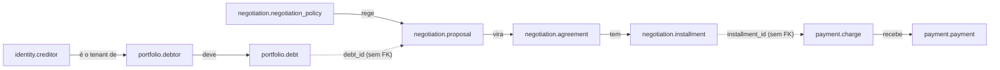
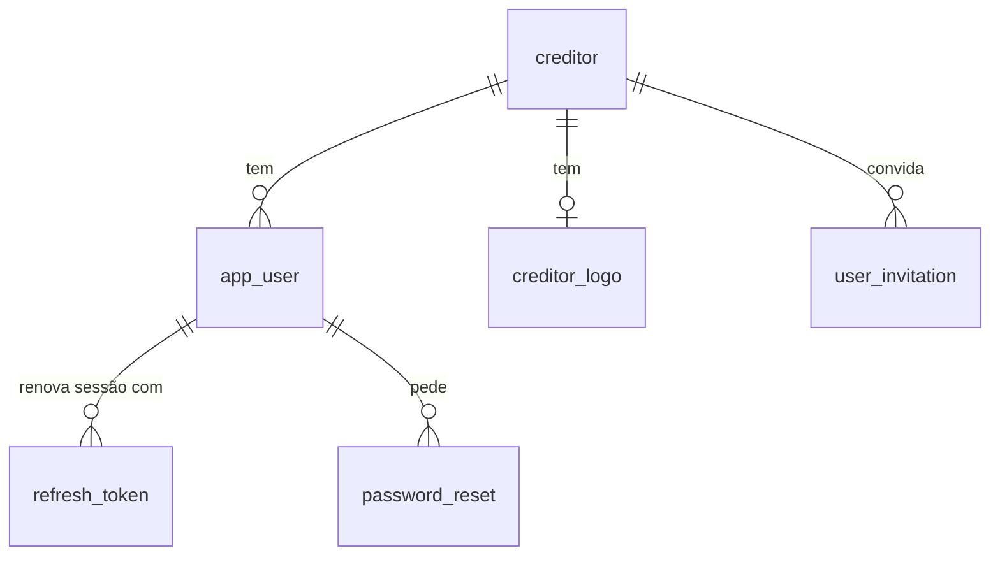
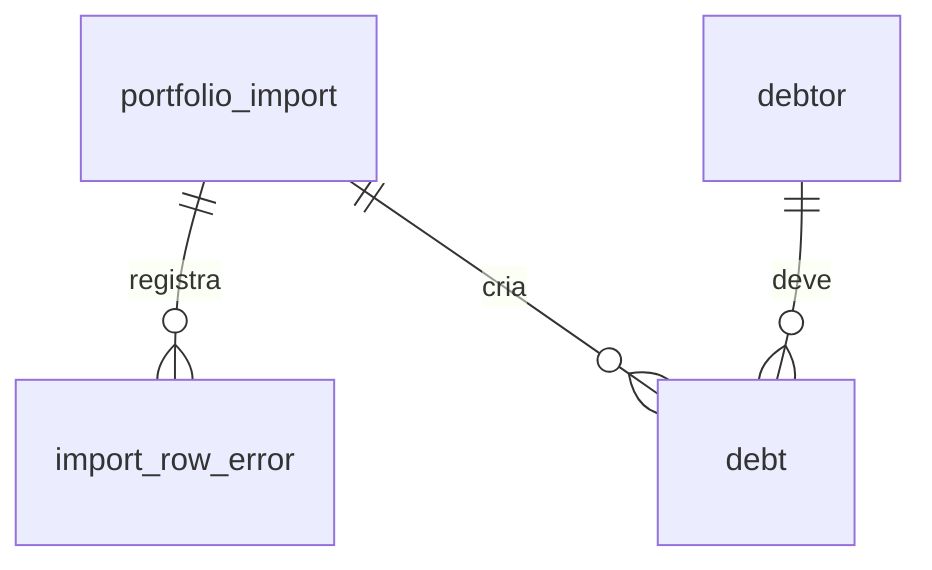
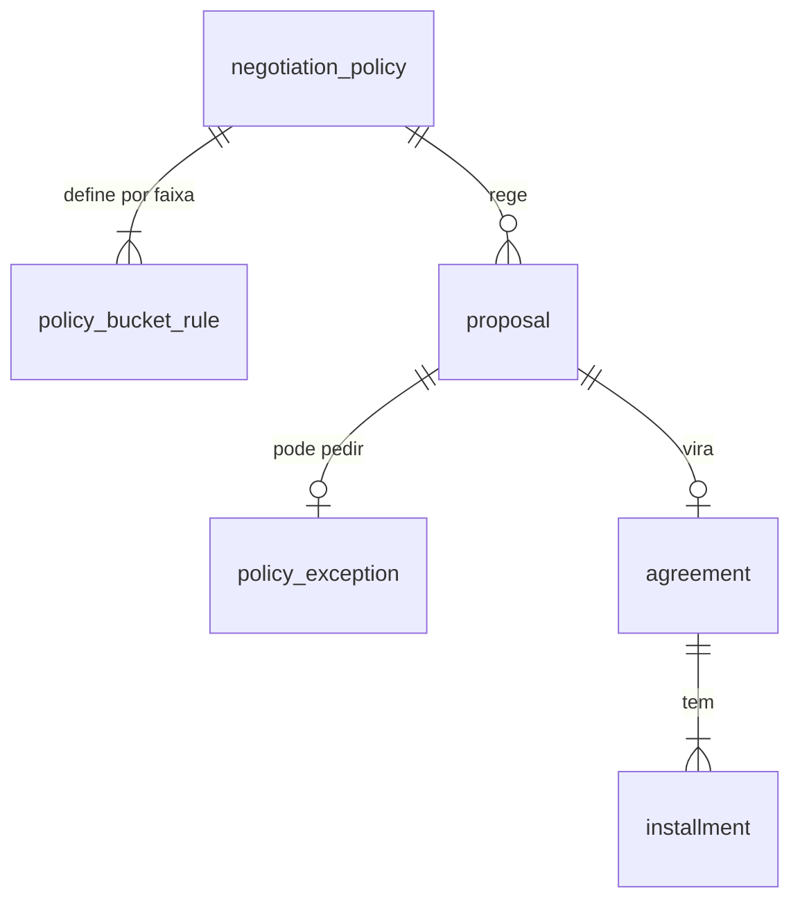
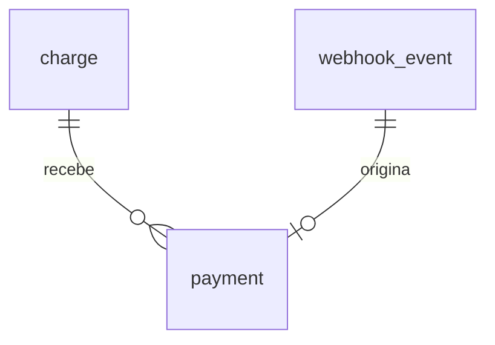
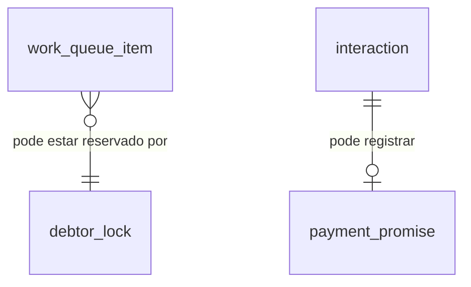

# LLD: banco de dados e modelagem

2026-11-10 · helloWorldRuan · Status: aprovado

Como os dados do Quita são organizados no PostgreSQL: schemas, tabelas, convenções, índices, migrações e multi-tenancy. A arquitetura que leva a isso está no HLD, seções "Dados" e "Arquitetura"; as regras de negócio que usam essas tabelas ficam no LLD da API (`docs/lld/api.md`).

## Onde mora cada fato

| Fato | Dono |
| --- | --- |
| Forma atual das tabelas (colunas, tipos, restrições) | As migrações Flyway do `quita-backend-api`, assim que existirem. Até lá, a forma **planejada** fica neste documento. |
| Convenções de nome, tipos, ids, tenancy, paginação | Este documento |
| Valores de regra (prazos, limites, tolerâncias) | LLD da API, "Valores e configuração" |
| Vocabulário (nome em português ↔ nome em código) | `GLOSSARY.md` |

Quando uma tabela ganhar a migração dela, a lista de colunas sai daqui e fica só o nome, a relação e a Situação `existe`.

## 1. Plataforma

- **PostgreSQL** gerenciado pelo Neon (versão: a mais recente que o Neon oferecer no plano gratuito, fixada no walking skeleton).
- **Local:** o mesmo PostgreSQL em contêiner, no `compose.yaml` do `quita-backend-api`, com a mesma versão.
- **Conexões:** a aplicação usa o endereço **com pool** do Neon (PgBouncer); o Flyway usa o endereço **direto**, porque migrações não funcionam bem atrás de pool em modo transação. O pool da aplicação (Hikari) fica pequeno, porque o plano gratuito limita conexões.
- **Extensões:** `pg_trgm` (busca por trecho de nome).

## 2. Schemas por módulo

Um schema por módulo da API. Cada módulo só escreve no próprio schema.

| Schema | Módulo | Situação |
| --- | --- | --- |
| `identity` | Identidade: Credoras, usuários, sessões, acesso do Devedor | planejada |
| `portfolio` | Carteira: importações, Devedores, Dívidas | planejada |
| `negotiation` | Negociação: Política, Proposta, Exceção, Acordo, Parcela, Contestação | planejada |
| `payment` | Pagamento: Cobrança, Pagamento, eventos de webhook | planejada |
| `collection` | Atendimento: Fila, reserva do Devedor, Tratativa, Promessa, Régua | planejada |
| `notification` | Notificação: caixa de saída, notificações internas, consentimento | planejada |
| `analytics` | Analytics: modelos de leitura do painel | planejada |
| `audit` | Auditoria: trilha de ações | planejada |
| `fake_gateway` | Gateway fake: cobranças do provedor simulado | planejada |
| `public` | Tabelas de bibliotecas: histórico do Flyway e registro de eventos do Spring Modulith | planejada |

## 3. Convenções

**Nomes**
- Tabelas e colunas em inglês, `snake_case`, tabela no singular (`debt`, `installment`), com o nome em código do `GLOSSARY.md`.
- Chave estrangeira: `<entidade>_id` (`debtor_id`). Índice: `ix_<tabela>_<colunas>`. Único: `uq_<tabela>_<colunas>`. Check: `ck_<tabela>_<regra>`.

**Ids**
- Chave primária `id uuid`, no formato **UUID v7**, gerado pela aplicação. O v7 começa pelo tempo, então os ids novos ficam juntos no índice (inserção rápida, como um número sequencial) sem expor quantos registros existem.

**Tipos**
| Dado | Tipo | Por quê |
| --- | --- | --- |
| Dinheiro | `numeric(15,2)` | Exato; mapeia para `BigDecimal`. Nunca `float`/`double`. |
| Taxas e percentuais | `numeric(7,4)` | 25% = `0.2500` |
| Instante | `timestamptz`, gravado em UTC | Momento exato de um evento |
| Data de negócio | `date` | Vencimento é uma data no fuso de São Paulo, não um instante |
| Estado (status, tipo) | `text` + `check` com a lista de valores | Acrescentar um valor é uma migração simples; o `enum` do PostgreSQL é difícil de mudar |
| Documento (CPF/CNPJ) | `text`, só dígitos | Validação e máscara ficam na aplicação |
| Dado flexível | `jsonb` | Só para payload de evento e dados de auditoria |

**Colunas padrão** em toda tabela de entidade: `id`, `tenant_id` (quando é dado de Credora), `created_at`, `updated_at`. Agregados que sofrem concorrência têm `version bigint` para lock otimista.

**Chaves estrangeiras** só dentro do mesmo schema. Entre módulos, a tabela guarda só o id, sem `foreign key` (ADR 0008). A consistência entre módulos vem dos eventos e das regras da aplicação.

**Exclusão:** não há exclusão física de dados de negócio. Estados finais (`canceled`, `archived`) encerram o ciclo; o pedido de exclusão da LGPD **anonimiza** os dados pessoais e mantém os registros financeiros.

## 4. Multi-tenancy

- Toda tabela com dado de Credora tem `tenant_id uuid not null`, igual ao `id` da Credora (ADR 0006).
- O filtro é aplicado pela camada de persistência (`@TenantId` do Hibernate), com o tenant tirado do token da requisição. Nenhuma consulta escreve o filtro à mão.
- **Todo índice e toda restrição única de tabela com tenant começam por `tenant_id`.** Assim, o índice serve à consulta filtrada e duas Credoras podem ter o mesmo número de contrato.
- Tabelas globais, sem tenant: `identity.creditor`, `identity.creditor_logo` (lida pelas rotas públicas do portal), `identity.password_reset` (o pedido chega sem tenant), `fake_gateway.*`, tabelas de bibliotecas.
- **Exceção à regra do índice:** `identity.app_user` tem índice único `lower(email)` global, sem `tenant_id`. No MVP, um e-mail é de uma Credora só (Requisitos RN1.5), e o login acha o usuário só pelo e-mail.
- **Exceção ao filtro:** o login procura o `app_user` pelo e-mail fora do filtro de tenant; o tenant da sessão vem do usuário encontrado.
- **Exceção ao filtro:** a contagem de devedores ativos por Credora, na lista do admin (B13), é uma consulta própria fora do filtro de tenant, liberada só para o papel `platform_admin`, que devolve só a contagem.
- Jobs que rodam para todas as Credoras (como a Quebra) percorrem as Credoras uma a uma, com o tenant definido em cada passada.
- Defesa extra com Row Level Security do PostgreSQL: a definir (Fase 3).

## 5. Modelo por schema

A forma abaixo é **planejada**. Colunas padrão (`id`, `tenant_id`, `created_at`, `updated_at`) ficam implícitas.

### 5.0 Visão geral

**O núcleo do domínio: 8 tabelas**

Seta cheia: chave estrangeira dentro do mesmo schema. Seta tracejada: referência só por id entre módulos (ADR 0008). O resto das tabelas apoia este núcleo: acesso (`identity`), importação (`portfolio`), atendimento (`collection`), mensagens (`notification`), números (`analytics`), rastro (`audit`).

**O fluxo da Ana, tabela por tabela**

1. A escola é uma linha em `creditor`; a importação cria `portfolio_import`, a Ana em `debtor` e a mensalidade em `debt`.
2. Ela pede acesso: `debtor_access_code` guarda o código, e `outbox_message` guarda o "e-mail" com ele.
3. Entra: `refresh_token` guarda a sessão.
4. Simula e confirma: `proposal` guarda a condição, regida pela `negotiation_policy` e pela `policy_bucket_rule` da faixa dela; a `debt` passa a `negotiating`.
5. O Acordo nasce: `agreement` (`awaiting_down_payment`) e cinco `installment`.
6. O Pix: `charge` da Entrada; o gateway grava em `fake_charge` e manda o webhook, que cai em `webhook_event` e vira `payment`.
7. Entrada paga: `installment` 1 fica `paid`, `agreement` fica `active`, `debt` fica `in_agreement`, e `daily_recovery` soma o valor.

**O que entra em cada fase**

| Fase | Tabelas | Quantidade |
| --- | --- | --- |
| MVP | `creditor`, `creditor_logo`, `app_user`, `user_invitation`, `password_reset`, `refresh_token`, `debtor_access_code`, `portfolio_import`, `import_row_error`, `debtor`, `debt`, `negotiation_policy`, `policy_bucket_rule`, `proposal`, `agreement`, `installment`, `charge`, `webhook_event`, `payment`, `work_queue_item`, `debtor_lock`, `interaction`, `payment_promise`, `outbox_message`, `daily_recovery`, `portfolio_aging`, `operator_performance`, `fake_charge` | 28 |
| Fase 2 | `policy_exception`, `dispute`, `in_app_notification`, `contact_consent`, `audit_log`, `collection_cadence`, `cadence_step` | 7 |
| Fase 3 | `conversation`, `chat_message` | 2 |

### 5.1 `identity`

**Diagrama ER: identity**

Uma linha por relação; `||--o{` é "um para muitos".

| Tabela | Colunas principais | Situação |
| --- | --- | --- |
| `creditor` | `legal_name`, `display_name`, `document` (CNPJ), `slug` (único), `kind` (escola, clínica...), `plan`, `status`, `brand_color` (hex do tema claro, nulo = tema padrão), `support_email`, `support_phone`, `logo_version` | planejada |
| `creditor_logo` | chave `creditor_id`, `content_type` (`image/png`, `image/webp`), `bytes` (`bytea`), `sha256`, `updated_at` | planejada |
| `app_user` | `email`, `name`, `password_hash`, `role` (`platform_admin`, `manager`, `operator`), `status`, `last_login_at` · único `lower(email)` em toda a tabela (global, seção 4) | planejada |
| `user_invitation` | `email`, `role`, `token_hash`, `expires_at`, `accepted_at` | planejada |
| `password_reset` | `user_id`, `token_hash` (único), `expires_at`, `used_at` | planejada |
| `refresh_token` | `subject_type` (`user`, `debtor`), `subject_id`, `token_hash`, `family_id`, `expires_at`, `revoked_at`, `replaced_by_id` | planejada |
| `debtor_access_code` | `debtor_id`, `code_hash`, `expires_at`, `attempts`, `consumed_at`, `locked_until` | planejada |

- Tokens e códigos são guardados só como **hash**, nunca o valor.
- `family_id` agrupa os refresh tokens de uma mesma sessão: se um token já usado aparecer de novo (sinal de roubo), a família inteira é revogada.
- O `platform_admin` é um `app_user` com `tenant_id` da própria plataforma (uma Credora interna "Quita").
- **Marca da Credora** (LLD da API, 5.11): a cor escura é calculada, não gravada. O logo fica no banco, num registro por Credora; trocar o logo grava o novo `sha256` e incrementa `logo_version`. O arquivo é PNG ou WebP, até 256 KB.
- `password_reset` é de uso único (`used_at`) e vale até `expires_at`; o token é procurado pelo hash, antes de se saber o tenant.

### 5.2 `portfolio`

**Diagrama ER: portfolio**

| Tabela | Colunas principais | Situação |
| --- | --- | --- |
| `portfolio_import` | `file_name`, `status` (`processing`, `completed`, `completed_with_errors`, `failed`), `failure_reason` (`early_fail_rate`, `unexpected`; nulo fora de `failed`), `total_rows`, `processed_rows`, `valid_rows`, `error_rows`, `ignored_rows`, `created_by`, `started_at`, `finished_at` | planejada |
| `import_row_error` | `portfolio_import_id`, `row_number`, `field`, `error_type`, `message`, `raw_line` (a linha original do arquivo, para o relatório corrigível) | planejada |
| `debtor` | `document_type` (`cpf`, `cnpj`), `document`, `name`, `email`, `phone` (só dígitos), `anonymized_at` · único `(tenant_id, document)` | planejada |
| `debt` | `debtor_id`, `portfolio_import_id` (a importação que criou a Dívida; nunca muda), `contract_number`, `description`, `principal_amount`, `amount_paid` (soma do que já foi pago em Acordos quebrados), `original_due_date`, `status` (`open`, `negotiating`, `in_agreement`, `settled`, `disputed`, `canceled`), `settled_externally_at`, `settled_externally_by` (o Gestor), `settled_externally_note` (nulos, salvo pagamento fora do Quita), `version` · único `(tenant_id, debtor_id, contract_number)` | planejada |

- A **Faixa de atraso** e o **Valor atualizado** não são gravados: são calculados a partir de `original_due_date` e `principal_amount` na data da consulta. Gravar daria um valor que envelhece todo dia.
- Uma importação por vez por Credora: índice único parcial em `portfolio_import (tenant_id) where status = 'processing'`.
- Uma linha do arquivo pode ter várias falhas: uma linha em `import_row_error` por falha, todas com o mesmo `row_number`. O `error_type` agrupa o resumo por tipo de erro da B08.
- Todo Devedor tem `email` ou `phone` (regra da aplicação, na importação e no cadastro manual). Reimportar atualiza só os campos que vieram preenchidos.
- `debt.portfolio_import_id` guarda a importação que **criou** a Dívida e nunca é sobrescrito: reimportar atualiza os dados, não a origem. É nulo na Dívida cadastrada à mão (`POST /debts`). O mês de entrada (safra, F21) sai de `debt.created_at`.
- Pagamento fora do Quita (LLD da API, 5.15): a Dívida vira `settled` e guarda quando, quem e a nota nas três colunas `settled_externally_*`. Quitada por Acordo, elas ficam nulas.

### 5.3 `negotiation`

**Diagrama ER: negotiation**

| Tabela | Colunas principais | Situação |
| --- | --- | --- |
| `negotiation_policy` | `version_number`, `status` (`draft`, `published`, `archived`), `valid_from`, `proposal_validity_hours`, `breach_tolerance_days`, `min_installment_amount` · único `(tenant_id, version_number)` | planejada |
| `policy_bucket_rule` | `negotiation_policy_id`, `min_overdue_days`, `max_overdue_days` (nulo = sem teto), `max_discount_rate`, `max_installments`, `min_down_payment_rate`, `installment_interest_rate` | planejada |
| `proposal` | `debt_id`, `negotiation_policy_id`, `channel` (`portal`, `backoffice`), `created_by_user_id` (o Operador, no canal `backoffice`; nulo no portal), `installments_count`, `discount_rate`, `updated_amount`, `negotiated_amount`, `down_payment_amount`, `expires_at`, `status` (`pending_approval`, `approved`, `rejected`, `expired`, `accepted`, `canceled`), `idempotency_key` · único `(tenant_id, idempotency_key)` | planejada |
| `policy_exception` | `proposal_id`, `requested_by`, `reason`, `decision` (`approved`, `rejected`), `decided_by`, `decided_at` | planejada |
| `agreement` | `debt_id`, `proposal_id`, `operator_id` (quem enviou a Proposta, ou o dono da Fila quando o Devedor fechou sozinho; nulo se nenhum; regra no LLD da API, 5.12), `status` (`awaiting_down_payment`, `active`, `settled`, `breached`, `canceled`), `total_amount`, `activated_at`, `settled_at`, `breached_at`, `canceled_at`, `version` | planejada |
| `installment` | `agreement_id`, `number` (1 = Entrada), `amount`, `due_date`, `status` (`pending`, `paid`, `canceled`), `paid_at`, `paid_amount` · único `(agreement_id, number)` | planejada |
| `dispute` | `debt_id`, `reason`, `attachment_key`, `status` (`open`, `accepted`, `rejected`), `resolved_by`, `resolved_at` | planejada |

- **Um Acordo vivo por Dívida, garantido pelo banco:** índice único parcial em `agreement (tenant_id, debt_id) where status in ('awaiting_down_payment', 'active')`. Se o Devedor e o Operador fecharem ao mesmo tempo, o segundo `insert` falha, e a API devolve 409. É a última linha de defesa, junto com o lock otimista da Dívida.
- A `proposal` guarda os valores calculados (`updated_amount`, `negotiated_amount`): o Acordo precisa do valor que o Devedor viu, e não de um recálculo no dia seguinte.
- **Uma Proposta aberta por Dívida:** índice único parcial em `proposal (tenant_id, debt_id) where status in ('approved', 'pending_approval')`. Uma Proposta nova encerra a anterior (`canceled`) na mesma transação, antes do `insert`.
- Cada Política tem de 1 a 5 `policy_bucket_rule`, sem sobreposição nem buraco, e só a última sem teto (regra da aplicação, LLD da API, 5.10). A primeira Política nasce com as 5 Faixas padrão.
- Um Acordo é de uma Dívida só no MVP (`agreement.debt_id`).
- A Política publicada é imutável: editar cria uma versão nova (`version_number + 1`), e a Proposta aponta para a versão que a regeu.
- "Atrasada" não é status gravado da Parcela: é `pending` com `due_date` no passado.

### 5.4 `payment`

**Diagrama ER: payment**

| Tabela | Colunas principais | Situação |
| --- | --- | --- |
| `charge` | `installment_id`, `method` (`pix`; `boleto` entra depois do MVP, com uma migração que amplia o `check`), `gateway_charge_id` (único), `amount`, `status` (`pending`, `paid`, `expired`, `canceled`), `pix_payload`, `expires_at` (o menor entre 24 h e o fim do último dia de pagamento da Parcela) | planejada |
| `webhook_event` | `gateway_event_id` (único), `event_type`, `payload` (`jsonb`), `signature_valid`, `received_at`, `processed_at`, `processing_error` | planejada |
| `payment` | `charge_id` (nulo se não conciliado), `webhook_event_id`, `amount`, `paid_at`, `status` (`reconciled`, `unreconciled`, `resolved_manually`) | planejada |

- **Idempotência do webhook pelo banco:** `gateway_event_id` é único. O mesmo evento chegando de novo bate na restrição e é ignorado.
- O evento cru fica gravado antes do processamento, para reprocessar se der erro. O job de Quebra confere os eventos ainda sem `processed_at` antes de quebrar um Acordo (LLD da API, 5.6).
- O motivo de um `payment` `unreconciled` não é gravado: sai dos dados (sem `charge_id`, valor diferente do da Cobrança, ou Cobrança que não estava `pending`).
- `webhook_event` não tem `tenant_id` na chegada (o gateway não conhece tenant); o tenant é descoberto pela `charge`, ou pela `external_reference` que a API mandou ao gateway. O `payment` sem nenhuma referência reconhecível fica sem tenant e vai para a fila do admin da plataforma.

### 5.5 `collection`

**Diagrama ER: collection**

| Tabela | Colunas principais | Situação |
| --- | --- | --- |
| `work_queue_item` | `debtor_id`, `operator_id`, `priority_score`, `reason`, `assigned_at`, `next_action_at` · único `(tenant_id, debtor_id)` | planejada |
| `debtor_lock` | chave `(tenant_id, debtor_id)`, `operator_id`, `locked_until` | planejada |
| `interaction` | `debtor_id`, `operator_id`, `type` (`call`, `message`, `note`, `promise`), `notes`, `occurred_at` | planejada |
| `payment_promise` | `interaction_id`, `promised_date`, `promised_amount`, `status` (`pending`, `kept`, `broken`) | planejada |
| `collection_cadence`, `cadence_step` | Régua de cobrança | a detalhar (Fase 2) |
| `conversation`, `chat_message` | Chat | a detalhar (Fase 3) |

- A reserva do Devedor (`debtor_lock`) é uma linha com prazo: pegar a reserva é um `insert ... on conflict do update ... where locked_until < now()`. Se nada mudou, outro Operador está com ela. Reserva vencida não precisa de job: a próxima tentativa sobrescreve a linha.

### 5.6 `notification`, `analytics`, `audit`, `fake_gateway`

| Tabela | Colunas principais | Situação |
| --- | --- | --- |
| `notification.outbox_message` | `channel` (`email`, `sms`), `recipient`, `template_key`, `body`, `status` (`scheduled`, `sent`, `skipped`), `scheduled_for`, `sent_at`, `skip_reason` | planejada |
| `notification.in_app_notification` | `user_id`, `type`, `payload` (`jsonb`), `read_at` | planejada (Fase 2, F16; no MVP, as notificações vêm só do SSE, sem histórico) |
| `notification.contact_consent` | `debtor_id`, `channel`, `opted_in`, `changed_at` | a detalhar (Fase 2) |
| `analytics.daily_recovery` | chave `(tenant_id, day)`, `recovered_amount`, `agreements_created`, `agreements_breached`, `agreements_settled` | planejada |
| `analytics.portfolio_aging` | chave `(tenant_id, policy_bucket_rule_id)`, `min_overdue_days`, `max_overdue_days`, `debts_count`, `total_amount`, `refreshed_at` (refeita a cada recálculo, com as Faixas da Política publicada) | planejada |
| `analytics.operator_performance` | chave `(tenant_id, operator_id, day)`, `agreements_created`, `recovered_amount` (regra de atribuição no LLD da API, 5.12) | planejada (MVP, F14) |
| `audit.audit_log` | `actor_type`, `actor_id`, `action`, `entity_type`, `entity_id`, `data` (`jsonb`), `ip_address`, `occurred_at` | planejada |
| `fake_gateway.fake_charge` | `external_reference`, `amount`, `method`, `status`, `webhook_url`, `paid_at`, `delivery_attempts` | planejada |

- **Auditoria só de escrita:** o papel de banco da aplicação não tem permissão de `update` nem de `delete` em `audit.audit_log`.
- Os modelos de `analytics` são atualizados por eventos e recalculáveis do zero a partir dos outros schemas.
- `public.event_publication` é a tabela do Spring Modulith que registra cada evento publicado e se já foi processado (o outbox). A forma dela é da biblioteca.

## 6. Índices das consultas principais

| Consulta | Índice |
| --- | --- |
| Dívidas de um Devedor | `debt (tenant_id, debtor_id)` |
| Listagem de Dívidas por atraso | `debt (tenant_id, status, original_due_date)` |
| Busca de Devedor por documento (início) | `debtor (tenant_id, document text_pattern_ops)` |
| Busca de Devedor por trecho do nome | GIN `pg_trgm` em `debtor (name)` |
| Busca de Devedor por telefone | `debtor (tenant_id, phone)` (só dígitos) |
| Fila de um Operador | `work_queue_item (tenant_id, operator_id, priority_score desc, id)` |
| Parcelas vencidas para o job de Quebra | `installment (tenant_id, status, due_date)` |
| Linha do tempo do Devedor | `interaction (tenant_id, debtor_id, occurred_at desc)` |
| Trilha de auditoria de uma entidade | `audit_log (tenant_id, entity_type, entity_id, occurred_at desc)` |

## 7. Paginação

- **Por cursor (keyset)** em toda listagem que pode crescer (Dívidas, Fila, Tratativas, auditoria). O cursor é a ordenação da página anterior mais o `id` como desempate, codificado em base64. A próxima página é `where (ordenação, id) < (valores do cursor)`. O custo não cresce com o número da página, ao contrário do `offset`.
- **Por `offset`** só em listas pequenas e administrativas (usuários, versões de Política), onde "ir para a página 5" faz sentido.
- O formato do cursor na API está no LLD da API.

## 8. Migrações

- **Flyway**, no `quita-backend-api`. Cada módulo tem a própria pasta (`db/migration/<module>`), e o Flyway lê todas.
- Nome: `V<AAAAMMDDHHmm>__<module>_<descricao>.sql` (ex.: `V202611111030__negotiation_create_agreement.sql`). O carimbo de tempo evita colisão de número entre branches.
- Migração aplicada **nunca** é editada: a correção é uma migração nova.
- Mudança que quebra quem já lê a tabela segue **expandir e contrair**: acrescenta o novo, migra os dados, publica o código novo, remove o antigo numa migração seguinte.
- As migrações rodam num passo próprio do deploy, antes de a aplicação subir, e não na subida da aplicação.
- **Os schemas já existem:** a migração `shared_create_schemas` do walking skeleton (F01) criou os nove schemas da seção 2. Cada tabela nova entra num schema existente, por uma migração nova da funcionalidade que a usa primeiro (o mapa está em `docs/review/mvp-baseline.md`, seção 4). Nenhuma funcionalidade do MVP cria schema novo.

## 9. Dados de desenvolvimento e demo

- **Seed de desenvolvimento:** uma Credora de exemplo (a escola da Ana), um usuário por papel, uma Política e algumas dezenas de Dívidas em todas as faixas. Carregado só no perfil local, nunca na demo.
- **Dados da demo:** gerados por script, com dados fictícios e CPFs válidos de teste, nunca reais.
- **Carga de 1 milhão de Dívidas** (Fase 3): script separado, usado no teste de desempenho.

## 10. Decisões

| ADR | Decisão |
| --- | --- |
| [0008](../adr/0008-no-cross-schema-foreign-keys.md) | Sem chave estrangeira entre schemas de módulos diferentes |

No texto: UUID v7 como id (seção "Ids"); estado como `text` + `check` (seção "Tipos"); Faixa de atraso e Valor atualizado calculados, não gravados (seção 5.2); paginação por cursor (seção 7).

## 11. Questões em aberto

- [ ] Row Level Security como defesa extra de tenancy (Fase 3).
- [ ] Tabelas da Régua (Fase 2) e do chat (Fase 3).
- [ ] Banco de prévia por PR com branch do Neon (HLD, "Questões em aberto").
- [ ] Acordo de várias Dívidas (Fase 2): hoje `agreement` aponta para uma `debt` só.
