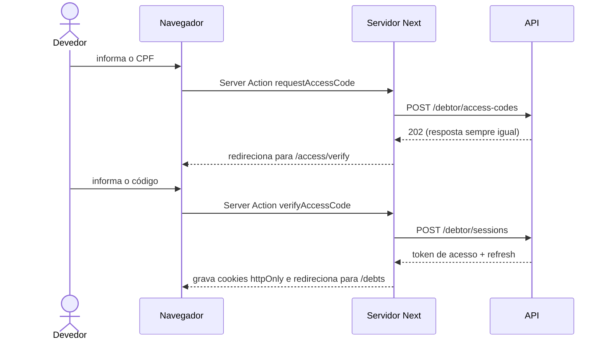

# LLD: portal do devedor (`quita-debtor-portal-web`)

2026-11-10 · helloWorldRuan · Status: aprovado

Como o portal funciona por dentro: rotas, renderização, sessão do Devedor, o papel de BFF, formulários, cache, white-label, desempenho e testes. O lugar do portal na arquitetura está no HLD (seções "Arquitetura" e "Segurança e privacidade"); as regras de negócio e o contrato, em `docs/lld/api.md`.

## Onde mora cada fato

| Fato | Dono |
| --- | --- |
| Rotas e estratégia de renderização de cada uma | Este documento, seções 3 e 4 |
| Forma das chamadas e respostas da API | Tipos gerados do `openapi.json` (ADR 0011) |
| Regras de cálculo (simulação, valores) | `docs/lld/api.md`, seção 5; o portal nunca calcula dinheiro |
| Cores, tipografia, componentes | `docs/design-system.md` (a criar) |
| Comandos | `AGENTS.md` do `quita-debtor-portal-web` |

## 1. Stack

| Peça | Escolha | Por quê |
| --- | --- | --- |
| Framework | Next.js, App Router, versão atual (fixada no walking skeleton) | SSR, Server Components, streaming, cache por rota |
| UI | React 19 | Server Components, hooks de formulário e `useOptimistic` |
| Estilo e componentes | Tailwind + shadcn/ui, com os tokens compartilhados | `docs/design-system.md` |
| Validação | Zod | Mesmo schema valida o formulário no cliente e a Server Action no servidor |
| Tipos da API | `openapi-typescript` | ADR 0011 |
| Testes | Vitest + Testing Library, Playwright com viewport de celular, axe | Seção 10 |
| Qualidade | ESLint (regras do Next e do React), Prettier, Lighthouse CI | Seção 9 |

Sem biblioteca de estado global nem de cache no cliente: o servidor entrega os dados, e o pouco estado do navegador (simulador, polling do Pix) vive em hooks próprios.

## 2. Front e BFF na mesma aplicação

O portal tem duas metades, no mesmo app Next.js: o **front** (as telas que rodam no navegador, mais o HTML gerado no servidor) e o **BFF** (Backend for Frontend: a camada de servidor que fala com a API em nome dessas telas). O navegador do Devedor **nunca fala com a API**: fala só com o servidor do Next, que fala com a API (HLD, "Segurança e privacidade").

- **Server Components** buscam os dados direto da API, no servidor, com o token da sessão.
- **Server Actions** fazem as mudanças (pedir código, entrar, fechar Acordo, gerar Pix, contestar).
- **Route handlers** (`app/bff/...`) atendem as leituras interativas do navegador que precisam ser canceláveis e rápidas (simulação enquanto o slider se move, status do Pix). Server Actions não servem para isso: elas rodam uma de cada vez e não são feitas para buscar dados.
- Todo acesso à API fica em `lib/api/` (funções de servidor com o pacote `server-only`, que quebra o build se alguém importar no cliente).

## 3. Rotas

Nomes de pasta em inglês (`AGENTS.md`). `[slug]` é o identificador público da Credora (ADR 0013).

| Rota | Tela | Acesso | Renderização |
| --- | --- | --- | --- |
| `/` | Página do Quita (o que é, link para a demo) | público | estática |
| `/c/[slug]` | Página da Credora: logo, explicação, "consultar minhas dívidas" | público | cache com tag da Credora |
| `/c/[slug]/access` | Informar CPF/CNPJ | público | dinâmica |
| `/c/[slug]/access/verify` | Informar o código | público | dinâmica |
| `/c/[slug]/debts` | Lista de Dívidas com Valor atualizado | Devedor | dinâmica, por usuário, streaming |
| `/c/[slug]/debts/[debtId]` | Detalhe + simulador | Devedor | dinâmica |
| `/c/[slug]/debts/[debtId]/breakdown` | "O que compõe este valor" | Devedor | modal por rota interceptada sobre a lista; página inteira se acessada direto |
| `/c/[slug]/agreements/[agreementId]` | Acompanhar o Acordo: Parcelas pagas e próximas | Devedor | dinâmica |
| `/c/[slug]/agreements/[agreementId]/installments/[installmentId]/pay` | Pix: QR Code, copia-e-cola, status ao vivo | Devedor | dinâmica |
| `/c/[slug]/debts/[debtId]/dispute` | Contestar (Fase 2) | Devedor | dinâmica |
| `/c/[slug]/chat` | Atendimento (Fase 3) | Devedor | dinâmica |

**Arquivos especiais por segmento:**
- `layout.tsx` de `/c/[slug]`: busca a marca da Credora e aplica o tema.
- Grupos de rota `(public)` e `(authenticated)`, cada um com o próprio layout.
- `loading.tsx` com esqueleto em cada página dinâmica; `error.tsx` com "tentar de novo"; `not-found.tsx` para slug ou Dívida inexistente.
- `@modal` (rota paralela) + `(.)breakdown` (rota interceptada) para o detalhamento do valor.

**Arquivos de metadados:** `generateMetadata` por Credora (título, descrição, Open Graph); `opengraph-image` gerada com o nome e as cores da Credora; `sitemap.ts` e `robots.ts` listando só as páginas públicas; todas as rotas `(authenticated)` com `noindex`.

## 4. Renderização e cache

| Tipo de dado | Estratégia | Por quê |
| --- | --- | --- |
| Página do Quita | Estática no build | Não muda |
| Página e marca da Credora | Cache marcado com a tag `creditor:<slug>`; revalidado sob demanda | Muda raramente; precisa ser rápida e indexável |
| Dados do Devedor (Dívidas, Acordos) | Sem cache, sempre do servidor | Dinheiro e estado mudam; dados pessoais |
| Simulação | Sem cache, pelo route handler | Calculada na API a cada mudança |

- As páginas do Devedor fazem **streaming**: o cabeçalho e o esqueleto aparecem na hora, e a lista chega quando a API responde (`Suspense` por bloco).
- **Revalidação sob demanda (Fase 2, white-label):** quando o Gestor publica a marca no backoffice, a API chama `POST /bff/revalidate` do portal, assinado com `REVALIDATE_SECRET`, que invalida a tag da Credora.
- A API exata de cache segue a versão fixada do Next (diretiva de cache e tags); a estratégia acima não muda com ela.

## 5. Sessão do Devedor

**Fluxo de entrada**

Setas cheias são chamadas; tracejadas, respostas.

- **Cookies do portal**, no domínio do portal: `quita_debtor_access` (token de acesso) e `quita_debtor_refresh` (refresh), ambos `HttpOnly`, `Secure`, `SameSite=Lax`. O JavaScript do navegador nunca vê os tokens.
- **Renovação:** toda chamada do servidor à API passa por uma função que, com o token de acesso vencido, renova pelo refresh e regrava os cookies antes de seguir.
- **Inatividade:** o refresh do Devedor expira com `DEBTOR_SESSION_IDLE_TIMEOUT` sem uso; a próxima ação leva de volta para `/access` com aviso.
- **Proteção das rotas:** o `proxy` do Next (antigo `middleware`) redireciona para `/access` quem chega a uma rota `(authenticated)` sem o cookie de sessão. A checagem de verdade é a da API: o `proxy` só evita renderizar a página à toa.
- **Sair:** Server Action que chama a API, apaga os cookies e volta para a página da Credora.

## 6. Formulários e interação

| Interação | Como | Comportamento exigido |
| --- | --- | --- |
| CPF e código | Server Action + `useActionState` + `useFormStatus` | Valida com Zod no cliente e no servidor; erro por campo; botão desabilitado enquanto envia; funciona com JavaScript desligado |
| Simulador | Client Component + route handler | Slider de Parcelas e campo de Entrada; recalcula na API sem travar o arraste (valor adiado com `useDeferredValue`); cancela a requisição anterior com `AbortController`; mostra o último resultado válido enquanto calcula |
| Fechar Acordo | Server Action com `Idempotency-Key` gerada uma vez por tela | Duplo clique não cria dois Acordos; 409 `AGREEMENT_ALREADY_EXISTS` explica que o acordo já foi fechado e leva até ele |
| Pix | Client Component com polling | Copiar o código com retorno visual; consulta o status a cada 3 s, só com a aba visível; para ao pagar ou expirar; confirmação aparece sem recarregar |
| "Já paguei" | `useOptimistic` | Mostra "pagamento em processamento" na hora, e o polling confirma ou desfaz |

Os valores de tempo (intervalo do polling, validade do Pix) seguem `docs/lld/api.md`, "Valores e configuração", quando são regra; o intervalo de 3 s é desta tela.

## 7. White-label

- O `layout.tsx` de `/c/[slug]` busca a marca (logo, cor de assinatura, textos) e aplica as cores como CSS custom properties no elemento raiz. Os componentes só usam os tokens; nenhum componente conhece a cor de uma Credora.
- Sem marca configurada, vale o tema padrão do Quita.
- Contraste mínimo AA garantido na publicação da marca (RN11.1), não no portal.
- No MVP, só logo e cor de assinatura vindos do cadastro; o editor de marca é da Fase 2.

## 8. Servidor da API acordando

- As chamadas do servidor do Next à API têm tempo limite e novas tentativas com intervalo crescente.
- Ao entrar em `/c/[slug]`, a página dispara um "acorda" para a API em segundo plano, para que ela esteja de pé quando o Devedor chegar às rotas com dados.
- Se a API demorar, o `loading.tsx` troca o esqueleto por "estamos preparando suas informações" depois de alguns segundos, em vez de deixar a tela parada.

## 9. Desempenho, acessibilidade e SEO

- **Orçamento:** LCP < 2,5 s em 4G (HLD, "Requisitos de qualidade"); JavaScript inicial das páginas públicas o menor possível, com os Client Components só onde há interação (simulador, Pix, formulários).
- `next/font` com a fonte do design system, sem salto de layout; `next/image` para o logo da Credora.
- Acessibilidade WCAG 2.2 AA: rótulos em todo campo, erros anunciados, foco gerenciado ao trocar de etapa, alvo de toque ≥ 44 px, o slider operável por teclado e por leitor de tela.
- Lighthouse CI no PR, falhando abaixo de 100 em Acessibilidade e abaixo do orçamento de desempenho.
- Cabeçalhos de segurança no `proxy`: CSP, `X-Content-Type-Options`, `Referrer-Policy`, `Permissions-Policy`.

## 10. Testes

| Nível | O que cobre | Ferramenta |
| --- | --- | --- |
| Unidade | Schemas Zod, formatação, a função de chamada à API com renovação | Vitest |
| Componente | Simulador, tela do Pix, formulários | Vitest + Testing Library + MSW |
| Ponta a ponta | O fluxo da Ana, do link ao Acordo pago, em viewport de celular | Playwright contra a API local, com o gateway fake |
| Acessibilidade | Páginas principais | axe no Playwright + Lighthouse CI |

## 11. Configuração

| Variável | Para quê |
| --- | --- |
| `API_INTERNAL_URL` | Endereço da API, usado só no servidor |
| `REVALIDATE_SECRET` | Assinatura da revalidação sob demanda |
| `NPM_TOKEN` | Instalar o pacote de tokens da org (`docs/design-system.md`) |

Nenhuma variável `NEXT_PUBLIC_*`: o navegador não precisa saber onde a API está.

## 12. Decisões

| ADR | Decisão |
| --- | --- |
| [0013](../adr/0013-creditor-path-instead-of-subdomain.md) | Portal da Credora por caminho (`/c/[slug]`), não por subdomínio |

No texto: Server Actions para mudanças e route handlers para leituras interativas (seção 2); tokens só em cookies httpOnly do portal (seção 5); sem estado global no cliente (seção 1).

## 13. Questões em aberto

- [ ] Editor de marca e revalidação sob demanda (Fase 2).
- [ ] Contestação com anexo: onde guardar o arquivo (Fase 2).
- [ ] Chat (Fase 3).
