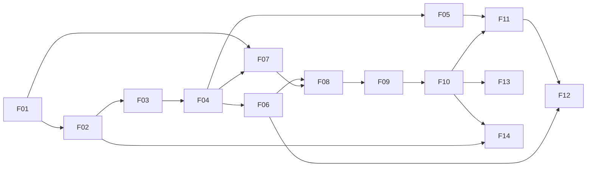

# Roadmap: Quita

2026-11-10 · helloWorldRuan · Status: rascunho para validação

A ordem em que o Quita é construído. Cada funcionalidade é uma **fatia vertical**: entrega algo que uma pessoa consegue fazer, de ponta a ponta (API + front), e fica publicada antes de a próxima começar. O escopo vem do `docs/product-brief.md`; as telas, de `design/hi-fi/`; os módulos e as regras, de `docs/lld/`.

## Onde mora cada fato

| Fato | Dono |
| --- | --- |
| Ordem, dependências, tamanho e status de cada funcionalidade | Este documento |
| Requisitos, spec e tarefas de uma funcionalidade | `docs/features/<NN>-<title>/` |
| Regras de negócio e valores | `docs/lld/api.md`, seções 5 e 6 |
| Telas e estados | `design/hi-fi/` e `design/prompts/` |

## Prazo e capacidade

- **Prazo:** 8 semanas, de 2026-11-10 a 2027-01-04 (56 dias).
- **Capacidade:** 4 h por dia, todos os dias (premissa: 7 dias por semana) = 224 h.
- **Tamanhos:** **P** = até 2 dias (8 h) · **M** = 3 a 4 dias (12 a 16 h) · **G** = 5 dias (20 h).

### O que cabe e o que sai

A soma do MVP, com uma pessoa aprendendo as tecnologias enquanto constrói, ocupa o prazo inteiro: 1 dia de planejamento + 52 dias de funcionalidades + 3 dias de vitrine. Por isso:

- **Dentro do prazo:** F01 a F14 (o MVP completo, publicado) e a vitrine.
- **Fora do prazo (backlog priorizado):** a Fase 2 (F15 a F19) e a Fase 3 (F20 a F22). O brief previa essas fases nas semanas 6 a 8; elas passam a ser continuação depois de 2027-01-04, na ordem deste documento.
- **Já simplificado no MVP para caber:** o painel (F14) entra com indicadores, recuperação por semana e aging (funil e ranking vão para a F21); as versões da Política (F06) entram como lista simples, sem exceções; a tela de Credoras (F03) é lista e cadastro, sem edição de marca.

**Ordem de corte, se atrasar** (corta de baixo para cima, sem quebrar o fluxo da Ana):

1. F13: a tela de pagamentos não conciliados (B11) sai; os jobs ficam.
2. F03: a tela de Credoras (B13) sai; a Credora de demonstração vem do seed.
3. F12: negociar pelo Operador (B06) sai; o Acordo fecha só pelo portal.
4. F14: o painel fica só com os quatro indicadores.

O chat (F20) é o primeiro item a nunca entrar se o backlog também apertar (`docs/product-brief.md`, "Riscos").

## Visão geral

| # | Funcionalidade | Fase | Tam. | Dias | Janela prevista | Status |
| --- | --- | --- | --- | --- | --- | --- |
| – | Planejamento e documentação | – | P | 1 | 10/11 | feito |
| F01 | Walking skeleton | MVP | G | 5 | 11/11 – 15/11 | planejada (PRD, spec e tarefas) |
| F02 | Acesso ao backoffice | MVP | G | 5 | 16/11 – 20/11 | a fazer |
| F03 | Credoras e usuários | MVP | P | 2 | 21/11 – 22/11 | a fazer |
| F04 | Importação de Carteira | MVP | G | 5 | 23/11 – 27/11 | a fazer |
| F05 | Busca de Devedores | MVP | M | 3 | 28/11 – 30/11 | a fazer |
| F06 | Política de negociação | MVP | M | 4 | 01/12 – 04/12 | a fazer |
| F07 | Acesso do Devedor ao portal | MVP | M | 4 | 05/12 – 08/12 | a fazer |
| F08 | Dívidas e simulador | MVP | M | 4 | 09/12 – 12/12 | a fazer |
| F09 | Fechar Acordo | MVP | M | 3 | 13/12 – 15/12 | a fazer |
| F10 | Pix e confirmação do pagamento | MVP | G | 5 | 16/12 – 20/12 | a fazer |
| F11 | Fila e ficha do Devedor | MVP | G | 5 | 21/12 – 25/12 | a fazer |
| F12 | Negociar pelo Devedor | MVP | P | 2 | 26/12 – 27/12 | a fazer |
| F13 | Quebra e pagamentos não conciliados | MVP | P | 2 | 28/12 – 29/12 | a fazer |
| F14 | Painel | MVP | M | 3 | 30/12 – 01/01 | a fazer |
| – | Vitrine (READMEs, demo, vídeo, caderno de entrevista) | – | M | 3 | 02/01 – 04/01 | a fazer |
| F15 | Versões e exceções da Política | Fase 2 | M | – | depois do prazo | backlog |
| F16 | Régua de cobrança e notificações | Fase 2 | G | – | depois do prazo | backlog |
| F17 | Auditoria e LGPD | Fase 2 | M | – | depois do prazo | backlog |
| F18 | White-label da Credora | Fase 2 | M | – | depois do prazo | backlog |
| F19 | Contestação de Dívida | Fase 2 | M | – | depois do prazo | backlog |
| F20 | Atendimento em tempo real (chat) | Fase 3 | G | – | depois do prazo | backlog |
| F21 | Painel completo | Fase 3 | M | – | depois do prazo | backlog |
| F22 | Escala e observabilidade | Fase 3 | G | – | depois do prazo | backlog |

**Dependências**

Seta: "precisa estar publicada antes". A ordem numérica já respeita todas as setas. O caminho F01 → F04 → F06 → F07 → F08 → F09 → F10 é o **fluxo da Ana**; F11 a F14 são o lado da Credora depois que o dinheiro entra.

## Ondas do MVP

### Onda 1 · Fundação (F01)

#### F01 · Walking skeleton

- **Objetivo:** todos os apps publicados e conversando de ponta a ponta, sem regra de negócio: o shell carrega o remote Operações e o Web Component do Analytics, o portal renderiza no servidor, e os três mostram o resultado do health check da API, que leu o banco.
- **Telas:** nenhuma do hi-fi; uma página técnica por app.
- **Módulos da API:** `shared` (esqueleto), Actuator, primeira migração Flyway.
- **Repos:** `quita-backend-api`, `quita-backoffice-web`, `quita-debtor-portal-web`.
- **Depende de:** nada.
- **Entrega também:** CI em cada repo (lint, testes, build), deploy na Vercel, no Render e no Neon, proxy `/api/*`, `main` protegida, tokens de design chegando aos três fronts, harness de cada repo (`AGENTS.md`, `CLAUDE.md`, regras da stack).
- **Tamanho:** G.

### Onda 2 · A Credora entra e sobe a Carteira (F02 a F06)

#### F02 · Acesso ao backoffice

- **Objetivo:** o usuário da Credora entra com e-mail e senha, continua logado ao recarregar, vê a moldura com o menu do papel dele e é mandado ao login quando a sessão acaba, sem perder a rota.
- **Telas:** B01 (login), B02 (moldura).
- **Módulos da API:** `identity` (login, refresh com rotação, logout, limite de taxa), `shared/tenant`, `shared/web` (Problem Details, `X-Request-Id`).
- **Repos:** `quita-backend-api`, `quita-backoffice-web` (shell, `libs/angular/session`, `data-access`, `ui`).
- **Depende de:** F01.
- **Tamanho:** G.

#### F03 · Credoras e usuários

- **Objetivo:** o Admin da plataforma cadastra uma Credora; o Gestor convida usuários por e-mail com um papel; o convidado cria a senha pelo link.
- **Telas:** B13 (Credoras), B12 (usuários e convites), B01 (aceitar convite).
- **Módulos da API:** `identity` (Credoras, convites), `notification` (caixa de saída simulada).
- **Repos:** `quita-backend-api`, `quita-backoffice-web` (`feature-admin`, shell).
- **Depende de:** F02.
- **Tamanho:** P.

#### F04 · Importação de Carteira

- **Objetivo:** o Gestor solta um CSV, confere a pré-visualização lida no navegador, envia vendo o progresso do upload, acompanha o processamento ao vivo e baixa o relatório de erros.
- **Telas:** B07 (importações e nova importação), B08 (andamento e erros).
- **Módulos da API:** `portfolio` (importação em lotes, Devedores, Dívidas), SSE (`/events/stream`).
- **Repos:** `quita-backend-api`, `quita-backoffice-web` (`feature-imports`, `libs/angular/realtime`).
- **Depende de:** F03.
- **Tamanho:** G.

#### F05 · Busca de Devedores

- **Objetivo:** o Operador e o Gestor acham um Devedor por nome, CPF parcial ou contrato, pela tela de busca ou pela busca global da moldura (atalho `/`), vendo o Valor atualizado das Dívidas.
- **Telas:** B04 (busca), B02 (busca global).
- **Módulos da API:** `portfolio` (busca com `Specification`, paginação por cursor, cálculo do Valor atualizado e da Faixa de atraso), `shared/money`.
- **Repos:** `quita-backend-api`, `quita-backoffice-web` (`feature-queue`, shell).
- **Depende de:** F04.
- **Tamanho:** M.

#### F06 · Política de negociação

- **Objetivo:** o Gestor edita o rascunho da Política por Faixa de atraso, testa no simulador ao lado com uma Dívida fictícia, publica, e vê a lista de versões.
- **Telas:** B09 (versões), B10 (editor).
- **Módulos da API:** `negotiation` (Política, publicação, Simulação).
- **Repos:** `quita-backend-api`, `quita-backoffice-web` (`feature-policies`).
- **Depende de:** F04 (precisa de Dívidas para simular).
- **Tamanho:** M.

### Onda 3 · O fluxo da Ana (F07 a F10)

#### F07 · Acesso do Devedor ao portal

- **Objetivo:** o Devedor abre a página da Credora, informa o CPF, recebe o código (na caixa de saída simulada), entra e é mantido em sessão com segurança; a página do Quita explica o produto.
- **Telas:** P00 (landing), P01 (página da Credora), P02 (CPF), P03 (código), P10 (estados globais).
- **Módulos da API:** `identity` (código de acesso, sessão do Devedor), `notification`.
- **Repos:** `quita-backend-api`, `quita-debtor-portal-web`.
- **Depende de:** F01, F04 (Devedores existem).
- **Tamanho:** M.

#### F08 · Dívidas e simulador

- **Objetivo:** o Devedor vê as Dívidas com o Valor atualizado e o que o compõe, e simula condições arrastando o seletor de Parcelas, com o cálculo vindo do servidor sem travar a tela.
- **Telas:** P04 (suas Dívidas), P05 (detalhe e composição), P06 (simulador).
- **Módulos da API:** `portfolio` (Dívidas do Devedor), `negotiation` (Simulação do Devedor).
- **Repos:** `quita-backend-api`, `quita-debtor-portal-web`.
- **Depende de:** F06, F07.
- **Tamanho:** M.

#### F09 · Fechar Acordo

- **Objetivo:** o Devedor revisa a condição e fecha o Acordo; duplo clique não cria dois, e um Acordo fechado ao mesmo tempo pelo Operador vira uma mensagem clara.
- **Telas:** P07 (revisar Acordo).
- **Módulos da API:** `negotiation` (Proposta, Acordo, Parcelas, máquina de estados, idempotência), eventos para `portfolio`.
- **Repos:** `quita-backend-api`, `quita-debtor-portal-web`.
- **Depende de:** F08.
- **Tamanho:** M.

#### F10 · Pix e confirmação do pagamento

- **Objetivo:** o Devedor paga a Entrada por Pix simulado, vê a confirmação chegar sozinha, o Acordo fica ativo e ele acompanha as Parcelas.
- **Telas:** P08 (Pix e Acordo fechado), P09 (acompanhar Acordo).
- **Módulos da API:** `payment` (Cobrança, webhook com HMAC, Conciliação), `fakegateway`, `negotiation` (ativação por evento), `analytics` (começa a somar `daily_recovery`).
- **Repos:** `quita-backend-api`, `quita-debtor-portal-web`.
- **Depende de:** F09.
- **Tamanho:** G.

### Onda 4 · O Operador e o Gestor (F11 a F14)

#### F11 · Fila e ficha do Devedor

- **Objetivo:** o Operador trabalha a Fila pelo teclado, abre a ficha (que reserva o Devedor), lê a linha do tempo, registra Tratativas e Promessas, e vê o pagamento cair ao vivo.
- **Telas:** B03 (Fila), B05 (ficha).
- **Módulos da API:** `collection` (Fila, reserva, Tratativa, Promessa), `portfolio` (ficha, linha do tempo), SSE.
- **Repos:** `quita-backend-api`, `quita-backoffice-web` (`feature-queue`).
- **Depende de:** F05, F10.
- **Tamanho:** G.

#### F12 · Negociar pelo Devedor

- **Objetivo:** o Operador simula e cria o Acordo pela ficha, vendo os limites da Política, e trata o conflito quando o Devedor fecha pelo portal ao mesmo tempo.
- **Telas:** B06 (negociar).
- **Módulos da API:** `negotiation` (Simulação e Proposta pelo backoffice).
- **Repos:** `quita-backend-api`, `quita-backoffice-web` (`feature-queue`, `ui`).
- **Depende de:** F06, F11.
- **Tamanho:** P.

#### F13 · Quebra e pagamentos não conciliados

- **Objetivo:** Parcela atrasada além da tolerância quebra o Acordo sozinha e devolve o Devedor à Fila; Entrada e Proposta vencidas se encerram; o Gestor resolve pagamentos de valor diferente.
- **Telas:** B11 (pagamentos não conciliados).
- **Módulos da API:** `negotiation` (jobs de Quebra, Entrada e Proposta vencidas), `payment` (resolução manual), `collection` (volta à Fila, Promessa vencida).
- **Repos:** `quita-backend-api`, `quita-backoffice-web` (`feature-payments`).
- **Depende de:** F10.
- **Tamanho:** P.

#### F14 · Painel

- **Objetivo:** o Gestor vê quanto recuperou, a taxa de recuperação, Acordos ativos e quebrados, a recuperação por semana e o aging da Carteira, com filtros na URL; o Operador vê só os números dele.
- **Telas:** B14 (painel).
- **Módulos da API:** `analytics` (modelos de leitura por evento, job de aging, rotas de resumo).
- **Repos:** `quita-backend-api`, `quita-backoffice-web` (`apps/analytics`, `libs/react/ui`, shell).
- **Depende de:** F02, F10.
- **Tamanho:** M.

### Vitrine

README de cada repo com o diagrama e os ADRs, demo pública com dados fictícios e um usuário por papel, vídeo curto do fluxo da Ana e a tag `v1.0.0` em cada repo.

## Backlog depois do prazo

### Fase 2 · Profundidade

| # | Funcionalidade | Objetivo | Telas | Módulos da API | Repos | Depende de | Tam. |
| --- | --- | --- | --- | --- | --- | --- | --- |
| F15 | Versões e exceções da Política | Versões com data de início; o Operador pede Exceção e o Gestor aprova ou recusa | B09, B10, B06 (estado 3) | `negotiation`, `notification` | API, backoffice | F12 | M |
| F16 | Régua de cobrança e notificações | O Gestor monta a Régua com modelos de mensagem; notificações internas no shell | a desenhar | `collection`, `notification` | API, backoffice | F11 | G |
| F17 | Auditoria e LGPD | Trilha de quem fez o quê; "entrar como"; CPF completo só com permissão e registro; anonimização | B02 (faixa), a desenhar | `audit`, `identity`, `portfolio` | API, backoffice | F11 | M |
| F18 | White-label da Credora | O Gestor define logo e cor com pré-visualização e contraste AA; o portal revalida sob demanda | a desenhar, P01 | `identity`, portal (`/bff/revalidate`) | API, backoffice, portal | F07 | M |
| F19 | Contestação de Dívida | O Devedor contesta com motivo e anexo; a Dívida fica suspensa até a análise | a desenhar | `negotiation`, `portfolio` | API, portal, backoffice | F08 | M |

### Fase 3 · Vitrine sênior

| # | Funcionalidade | Objetivo | Telas | Módulos da API | Repos | Depende de | Tam. |
| --- | --- | --- | --- | --- | --- | --- | --- |
| F20 | Atendimento em tempo real | Chat entre Devedor e Operador, com o mesmo componente nos dois apps | a desenhar | `collection` (WebSocket) | API, backoffice, portal | F11 | G |
| F21 | Painel completo | Funil, ranking de operadores, conversão do autoatendimento, exportação em PDF | B14 (completo) | `analytics` | API, backoffice | F14 | M |
| F22 | Escala e observabilidade | Carga de 1 milhão de Dívidas, p95 < 300 ms provado, Row Level Security, tracing | nenhuma | todos | API, `quita-docs` | F14 | G |

## Questões em aberto

- [ ] Confirmar a premissa de 7 dias por semana; com 5 dias, o prazo cobre até a F10 (o fluxo da Ana completo) e a onda 4 vira backlog.
- [ ] Pagamento depois da Quebra: crédito ou estorno (`docs/lld/api.md`, seção 14); decidir antes da F13.
- [ ] Boleto além do Pix: fora do MVP neste roadmap.
- [ ] Telas da Fase 2 e da Fase 3 ainda não desenhadas.
