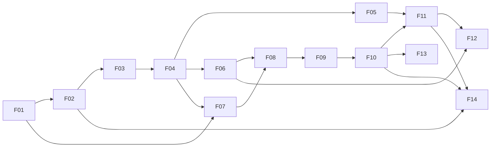

# Roadmap: Quita

2026-11-10 · helloWorldRuan · Status: rascunho para validação

A ordem em que o Quita é construído. Cada funcionalidade é uma **fatia vertical**: entrega algo que uma pessoa consegue fazer, de ponta a ponta (API + front), e fica publicada antes de a próxima começar. O escopo vem do `docs/product-brief.md`; as telas, de `design/hi-fi/`; os módulos e as regras, de `docs/lld/`.

## Onde mora cada fato

| Fato | Dono |
| --- | --- |
| Ordem, dependências, tamanho e status de cada funcionalidade | Este documento |
| Requisitos, spec e tarefas de uma funcionalidade | `docs/features/<NN>-<title>/` |
| Regras de negócio e valores | `docs/lld/api.md`, seções 5 e 6 |
| Telas e estados | `design/hi-fi/` e `design/prompts/` |

## Prazo e capacidade

- **Prazo:** 8 semanas, de 2026-11-10 a 2027-01-04 (56 dias), mais 1 dia aceito em 2026-11-12: a vitrine termina em 2027-01-05.
- **Capacidade:** 4 h por dia, todos os dias (premissa: 7 dias por semana) = 224 h.
- **Tamanhos:** **P** = até 2 dias (8 h) · **M** = 3 a 4 dias (12 a 16 h) · **G** = 5 dias (20 h).

### O que cabe e o que sai

A soma do MVP, com uma pessoa aprendendo as tecnologias enquanto constrói, ocupa o prazo inteiro: 1 dia de planejamento + 53 dias de funcionalidades + 3 dias de vitrine = 57 dias, **1 dia além** dos 56 (a F12 cresceu com a Proposta do Operador e o pagamento fora do Quita, decisão de 2026-11-12; ver "Questões em aberto"). Por isso:

- **Dentro do prazo:** F01 a F14 (o MVP completo, publicado) e a vitrine.
- **Fora do prazo (backlog priorizado):** a Fase 2 (F15 a F19) e a Fase 3 (F20 a F22), continuação depois de 2027-01-05, na ordem deste documento.
- **Já simplificado no MVP para caber:** o painel (F14) entra com indicadores, recuperação por semana e aging (funil e ranking vão para a F21); as versões da Política (F06) entram como lista simples, sem exceções; a tela de Credoras (F03) é lista e cadastro; o cadastro leva os dados de marca do portal (nome de exibição, logo, cor, contato), preenchidos pelo admin, e o editor de marca do Gestor fica na F18.

**Ordem de corte, se atrasar** (corta de baixo para cima, sem quebrar o fluxo da Ana):

1. F13: a tela de pagamentos não conciliados (B11) sai; os jobs ficam.
2. F03: a tela de Credoras (B13) sai; a Credora de demonstração vem do seed.
3. F12: a Proposta do Operador (B06 e o aceite na P07) sai; o Acordo fecha só pelo portal. O "Registrar pagamento fora do Quita" fica (é pequeno e resolve a Dívida paga na secretaria).
4. F14: o painel fica só com os quatro indicadores.

O chat (F20) é o primeiro item a nunca entrar se o backlog também apertar (`docs/product-brief.md`, "Riscos").

## Visão geral

| # | Funcionalidade | Fase | Tam. | Dias | Janela prevista | Status |
| --- | --- | --- | --- | --- | --- | --- |
| – | Planejamento e documentação | – | P | 1 | 10/11 | feito |
| F01 | Walking skeleton | MVP | G | 5 | 11/11 – 15/11 | planejada (PRD, spec e tarefas) |
| F02 | Acesso ao backoffice | MVP | G | 5 | 16/11 – 20/11 | a fazer |
| F03 | Credoras e usuários | MVP | P | 2 | 21/11 – 22/11 | a fazer |
| F04 | Importação de Carteira | MVP | G | 5 | 23/11 – 27/11 | a fazer |
| F05 | Busca de Devedores | MVP | M | 3 | 28/11 – 30/11 | a fazer |
| F06 | Política de negociação | MVP | M | 4 | 01/12 – 04/12 | a fazer |
| F07 | Acesso do Devedor ao portal | MVP | M | 4 | 05/12 – 08/12 | a fazer |
| F08 | Dívidas e simulador | MVP | M | 4 | 09/12 – 12/12 | a fazer |
| F09 | Fechar Acordo | MVP | M | 3 | 13/12 – 15/12 | a fazer |
| F10 | Pix e confirmação do pagamento | MVP | G | 5 | 16/12 – 20/12 | a fazer |
| F11 | Fila e ficha do Devedor | MVP | G | 5 | 21/12 – 25/12 | a fazer |
| F12 | Proposta do Operador e pagamento fora do Quita | MVP | M | 3 | 26/12 – 28/12 | a fazer |
| F13 | Quebra e pagamentos não conciliados | MVP | P | 2 | 29/12 – 30/12 | a fazer |
| F14 | Painel | MVP | M | 3 | 31/12 – 02/01 | a fazer |
| – | Vitrine (READMEs, demo, vídeo) | – | M | 3 | 03/01 – 05/01 | a fazer |
| F15 | Versões e exceções da Política | Fase 2 | M | – | depois do prazo | backlog |
| F16 | Régua de cobrança e notificações | Fase 2 | G | – | depois do prazo | backlog |
| F17 | Auditoria e LGPD | Fase 2 | M | – | depois do prazo | backlog |
| F18 | White-label da Credora | Fase 2 | M | – | depois do prazo | backlog |
| F19 | Contestação de Dívida | Fase 2 | M | – | depois do prazo | backlog |
| F20 | Atendimento em tempo real (chat) | Fase 3 | G | – | depois do prazo | backlog |
| F21 | Painel completo | Fase 3 | M | – | depois do prazo | backlog |
| F22 | Escala e observabilidade | Fase 3 | G | – | depois do prazo | backlog |

**Dependências**

Seta: "precisa estar publicada antes". A ordem numérica já respeita todas as setas. Em 2026-11-12, a F12 passou de P (2 dias) para M (3 dias); só as janelas da F12 em diante andaram 1 dia, o resto do calendário não mudou. O caminho F01 → F04 → F06 → F07 → F08 → F09 → F10 é o **fluxo da Ana**; F11 a F14 são o lado da Credora depois que o dinheiro entra.

## Ondas do MVP

### Onda 1 · Fundação (F01)

#### F01 · Walking skeleton

- **Objetivo:** todos os apps publicados e conversando de ponta a ponta, sem regra de negócio: o shell carrega o remote Operações e o Web Component do Analytics, o portal renderiza no servidor, e os três mostram o resultado do health check da API, que leu o banco.
- **Telas:** nenhuma do hi-fi; uma página técnica por app.
- **Módulos da API:** `shared` (esqueleto), Actuator, primeira migração Flyway.
- **Repos:** `quita-backend-api`, `quita-backoffice-web`, `quita-debtor-portal-web`.
- **Depende de:** nada.
- **Entrega também:** CI em cada repo (lint, testes, build), deploy na Vercel, no Render e no Neon, proxy `/api/*`, `main` protegida, tokens de design chegando aos três fronts, harness de cada repo (`AGENTS.md`, `CLAUDE.md`, regras da stack).
- **Tamanho:** G.

### Onda 2 · A Credora entra e sobe a Carteira (F02 a F06)

#### F02 · Acesso ao backoffice

- **Objetivo:** o usuário da Credora entra com e-mail e senha, recupera a senha pelo link enviado por e-mail, continua logado ao recarregar, vê a moldura com o menu do papel dele e é mandado ao login quando a sessão acaba, sem perder a rota.
- **Telas:** B01 (login e "Esqueci minha senha"), B02 (moldura).
- **Módulos da API:** `identity` (login, refresh com rotação, logout, limite de taxa, recuperação de senha com `password_reset`), `notification` (e-mail na caixa de saída), `shared/tenant`, `shared/web` (Problem Details, `X-Request-Id`).
- **Repos:** `quita-backend-api`, `quita-backoffice-web` (shell, `libs/shared/angular/session`, `data-access`, `ui`).
- **Depende de:** F01.
- **Tamanho:** G.

#### F03 · Credoras e usuários

- **Objetivo:** o Admin da plataforma cadastra uma Credora, com os dados de marca do portal (nome de exibição, logo PNG/WebP, cor de assinatura com contraste AA validado, e-mail e telefone de atendimento); o Gestor convida usuários por e-mail com um papel (gestor ou operador: não há papel só leitura no MVP), reenvia convite, muda papel e desativa; o convidado cria a senha pelo link.
- **Telas:** B13 (Credoras), B12 (usuários e convites), B01 (aceitar convite).
- **Módulos da API:** `identity` (Credoras com marca e `creditor_logo`, convites, `PATCH /users/{id}`, contagem de devedores ativos do admin), `notification` (caixa de saída simulada).
- **Repos:** `quita-backend-api`, `quita-backoffice-web` (`feature-admin`, shell).
- **Depende de:** F02.
- **Tamanho:** P, no limite: os campos de marca deixam a F03 um pouco maior.

#### F04 · Importação de Carteira

- **Objetivo:** o Gestor baixa o modelo em português, solta um CSV (UTF-8 ou o do Excel), vê o arquivo inteiro validado no navegador com o resumo por tipo de erro, envia vendo o progresso do upload, acompanha o processamento ao vivo e baixa o relatório de erros (as linhas originais com a coluna "Erro"), que corrige e reenvia.
- **Telas:** B07 (importações e nova importação), B08 (andamento e erros).
- **Módulos da API:** `portfolio` (importação em lotes, Devedores, Dívidas), SSE (`/events/stream`).
- **Repos:** `quita-backend-api`, `quita-backoffice-web` (`libs/operations/feature-imports`, `libs/shared/angular/realtime`).
- **Depende de:** F03.
- **Tamanho:** G.

#### F05 · Busca de Devedores

- **Objetivo:** o Operador e o Gestor acham um Devedor por nome, CPF parcial, contrato ou telefone, pela tela de busca ou pela busca global da moldura (atalho `/`), vendo o Valor atualizado das Dívidas; e cadastram à mão uma Dívida avulsa ("Nova dívida"), com a mesma validação da importação.
- **Telas:** B04 (busca e "Nova dívida"), B02 (busca global).
- **Módulos da API:** `portfolio` (busca com `Specification`, índice de telefone, paginação por cursor, cálculo do Valor atualizado e da Faixa de atraso, `POST /debts`), `shared/money`.
- **Repos:** `quita-backend-api`, `quita-backoffice-web` (`feature-queue`, shell).
- **Depende de:** F04.
- **Tamanho:** M.

#### F06 · Política de negociação

- **Objetivo:** o Gestor edita o rascunho da Política por Faixa de atraso (de 1 a 5 Faixas, começando pelas 5 padrão), testa no simulador ao lado com uma Dívida de exemplo (as regras ainda não salvas, por `POST /policies/simulations`, sem gravar nada), publica, e vê a lista de versões.
- **Telas:** B09 (versões), B10 (editor).
- **Módulos da API:** `negotiation` (Política, publicação, Simulação).
- **Repos:** `quita-backend-api`, `quita-backoffice-web` (`feature-policies`).
- **Depende de:** F04 (precisa de Dívidas para simular).
- **Tamanho:** M.

### Onda 3 · O fluxo da Ana (F07 a F10)

#### F07 · Acesso do Devedor ao portal

- **Objetivo:** o Devedor abre a página da Credora (com a marca e o contato do cadastro), informa o CPF, recebe o código (na caixa de saída simulada, `/demo/inbox` na demo), entra e é mantido em sessão com segurança, uma Credora por sessão; a página do Quita explica o produto.
- **Telas:** P00 (landing), P01 (página da Credora), P02 (CPF), P03 (código), P10 (estados globais).
- **Módulos da API:** `identity` (rota pública da Credora e do logo, código de acesso, sessão do Devedor), `notification`.
- **Repos:** `quita-backend-api`, `quita-debtor-portal-web`.
- **Depende de:** F01, F04 (Devedores existem).
- **Tamanho:** M.

#### F08 · Dívidas e simulador

- **Objetivo:** o Devedor vê as Dívidas e os Acordos (`GET /debtor/agreements`) com o Valor atualizado e o que o compõe, e simula condições arrastando o seletor de Parcelas, com o cálculo vindo do servidor sem travar a tela; sem Política publicada, a tela diz que as condições ainda não estão disponíveis (`NO_PUBLISHED_POLICY`).
- **Telas:** P04 (suas Dívidas), P05 (detalhe e composição), P06 (simulador).
- **Módulos da API:** `portfolio` (Dívidas do Devedor), `negotiation` (Simulação do Devedor).
- **Repos:** `quita-backend-api`, `quita-debtor-portal-web`.
- **Depende de:** F06, F07.
- **Tamanho:** M.

#### F09 · Fechar Acordo

- **Objetivo:** o Devedor revisa a condição e fecha o Acordo; duplo clique não cria dois, e um Acordo fechado ao mesmo tempo pelo Operador vira uma mensagem clara.
- **Telas:** P07 (revisar Acordo).
- **Módulos da API:** `negotiation` (Proposta, Acordo, Parcelas, máquina de estados, idempotência; `agreement.operator_id` nasce nulo e passa a ser preenchido na F11), eventos para `portfolio`.
- **Repos:** `quita-backend-api`, `quita-debtor-portal-web`.
- **Depende de:** F08.
- **Tamanho:** M.

#### F10 · Pix e confirmação do pagamento

- **Objetivo:** o Devedor paga a Entrada por Pix simulado, vê a confirmação chegar sozinha, o Acordo fica ativo, e ele acompanha as Parcelas.
- **Telas:** P08 (Pix e Acordo fechado), P09 (acompanhar Acordo).
- **Módulos da API:** `payment` (Cobrança da Entrada criada com o Acordo, Pix sob demanda com validade limitada ao último dia de pagamento, webhook com HMAC, Conciliação só de Cobrança `pending`), `fakegateway`, `negotiation` (ativação por evento), `analytics` (começa a somar `daily_recovery`).
- **Repos:** `quita-backend-api`, `quita-debtor-portal-web`.
- **Depende de:** F09.
- **Tamanho:** G.

### Onda 4 · O Operador e o Gestor (F11 a F14)

#### F11 · Fila e ficha do Devedor

- **Objetivo:** o Operador trabalha a Fila pelo teclado, abre a ficha (que reserva o Devedor; quem chega depois vê quem está atendendo e até quando), lê a linha do tempo, registra Tratativas e Promessas, e vê o pagamento cair ao vivo. Os indicadores de Acordos e valor da B03 entram na F14 (`operator_performance`); aqui, só "Na sua fila".
- **Telas:** B03 (Fila), B05 (ficha).
- **Módulos da API:** `collection` (Fila, reserva, Tratativa, Promessa, `CollectionApi` com o Operador da Fila para o `agreement.operator_id`), `portfolio` (ficha, linha do tempo), SSE.
- **Repos:** `quita-backend-api`, `quita-backoffice-web` (`feature-queue`).
- **Depende de:** F05, F10.
- **Tamanho:** G.

#### F12 · Proposta do Operador e pagamento fora do Quita

- **Objetivo:** o Operador simula pela ficha, vendo os limites da Política, e **envia uma Proposta** à Ana (nunca cria o Acordo direto); a Ana recebe o link por e-mail e SMS, entra com o código, vê a Proposta e aceita com "Li e concordo", e só então nasce o Acordo. Uma Proposta aberta por Dívida; se a Ana fechar outra condição sozinha, o primeiro Acordo vale. O Gestor registra, na ficha, uma Dívida paga fora do Quita, com nota obrigatória.
- **Telas:** B06 (enviar proposta), B05 (Proposta aberta na Dívida e "Registrar pagamento fora do Quita"), P07 (Proposta recebida), P04 (Proposta aberta no card).
- **Módulos da API:** `negotiation` (Proposta pelo backoffice, aceite do Devedor, encerramento da Proposta aberta, `ExternalPaymentRecorded`), `notification` (link da Proposta), `portfolio` (Dívida `settled` por pagamento fora do Quita), `collection` (sai da Fila).
- **Repos:** `quita-backend-api`, `quita-backoffice-web` (`feature-queue`, `ui`), `quita-debtor-portal-web` (rota `/c/[slug]/proposals/[proposalId]`).
- **Depende de:** F06, F09, F11.
- **Tamanho:** M (era P; cresceu em 2026-11-12 com o aceite no portal e o pagamento fora do Quita).

#### F13 · Quebra e pagamentos não conciliados

- **Objetivo:** Parcela atrasada além da tolerância quebra o Acordo sozinha e devolve o Devedor à Fila, sem nunca quebrar um Acordo pago no prazo (a Quebra confere os pagamentos antes); Entrada e Proposta vencidas se encerram; o Gestor resolve pagamentos de valor diferente, sem Cobrança ou chegados depois da Quebra.
- **Telas:** B11 (pagamentos não conciliados).
- **Módulos da API:** `negotiation` (jobs de Quebra e de Entrada vencida a partir das 03:00, por condição, Proposta vencida; `POST /internal/jobs/run` chamado a cada hora por um workflow agendado do GitHub Actions, que acorda a API), `payment` (`PaymentApi` para a conferência da Quebra, cancelamento das Cobranças do Acordo encerrado, resolução manual; pagamento sem referência vai para o admin da plataforma), `collection` (volta à Fila, Promessa vencida).
- **Repos:** `quita-backend-api`, `quita-backoffice-web` (`feature-payments`).
- **Depende de:** F10.
- **Tamanho:** P.

#### F14 · Painel

- **Objetivo:** o Gestor vê quanto recuperou, a taxa de recuperação, Acordos ativos e quebrados, a recuperação por semana e o aging da Carteira, com filtros na URL (período e Operador, este só para o Gestor); o Operador vê só os números dele. O aging já mostra o valor por Faixa; o filtro por Faixa é da F21. A F14 também liga os indicadores "Acordos hoje" e "Recuperado hoje" da Fila (B03).
- **Telas:** B14 (painel), B03 (indicadores do Operador).
- **Módulos da API:** `analytics` (modelos de leitura por evento, `operator_performance` com a atribuição ao Operador da Fila, job de aging pelas Faixas da Política publicada, rotas de resumo).
- **Repos:** `quita-backend-api`, `quita-backoffice-web` (`apps/analytics`, `libs/analytics/feature-dashboard`, `libs/analytics/ui`, shell).
- **Depende de:** F02, F10, F11.
- **Tamanho:** M.

### Vitrine

README de cada repo com o diagrama e os ADRs, demo pública com dados fictícios e um usuário por papel, vídeo curto do fluxo da Ana e a tag `v1.0.0` em cada repo.

## Backlog depois do prazo

### Fase 2 · Profundidade

| # | Funcionalidade | Objetivo | Telas | Módulos da API | Repos | Depende de | Tam. |
| --- | --- | --- | --- | --- | --- | --- | --- |
| F15 | Versões e exceções da Política | Versões com data de início; o Operador pede Exceção e o Gestor aprova ou recusa | B09, B10, B06 (estado 3) | `negotiation`, `notification` | API, backoffice | F12 | M |
| F16 | Régua de cobrança e notificações | O Gestor monta a Régua com modelos de mensagem; notificações internas no shell | a desenhar | `collection`, `notification` | API, backoffice | F11 | G |
| F17 | Auditoria e LGPD | Trilha de quem fez o quê; "entrar como"; CPF completo só com permissão e registro; anonimização. Um papel só de leitura fica como ideia, sem estar planejado | B02 (faixa), a desenhar | `audit`, `identity`, `portfolio` | API, backoffice | F11 | M |
| F18 | White-label da Credora | O próprio Gestor define logo e cor com pré-visualização ao vivo (no MVP, o admin preenche no cadastro, F03); o portal revalida sob demanda | a desenhar, P01 | `identity`, portal (`/bff/revalidate`) | API, backoffice, portal | F07 | M |
| F19 | Contestação de Dívida | O Devedor contesta com motivo e anexo; a Dívida fica suspensa até a análise | a desenhar | `negotiation`, `portfolio` | API, portal, backoffice | F08 | M |

### Fase 3 · Vitrine sênior

| # | Funcionalidade | Objetivo | Telas | Módulos da API | Repos | Depende de | Tam. |
| --- | --- | --- | --- | --- | --- | --- | --- |
| F20 | Atendimento em tempo real | Chat entre Devedor e Operador, com o mesmo componente nos dois apps | a desenhar | `collection` (WebSocket) | API, backoffice, portal | F11 | G |
| F21 | Painel completo | Funil, ranking de operadores, conversão do autoatendimento, comparação por safra (mês em que a Dívida entrou), filtro por Faixa, exportação em PDF | B14 (completo) | `analytics` | API, backoffice | F14 | M |
| F22 | Escala e observabilidade | Carga de 1 milhão de Dívidas, p95 < 300 ms provado, Row Level Security, tracing | nenhuma | todos | API, `quita-docs` | F14 | G |

## Questões em aberto

- [ ] Confirmar a premissa de 7 dias por semana; com 5 dias, o prazo cobre até a F10 (o fluxo da Ana completo) e a onda 4 vira backlog.
- [x] A F12 cresceu 1 dia (2026-11-12): **aceito**, a vitrine termina em 05/01. O comprovante em PDF saiu do MVP (dependência nova para pouco ganho) e serve de folga.
- [x] Pagamento depois da Quebra: sem crédito nem estorno no MVP (`docs/lld/api.md`, 5.6).
- [x] Boleto além do Pix: fora do MVP.
- [ ] Telas da Fase 2 e da Fase 3 ainda não desenhadas.
