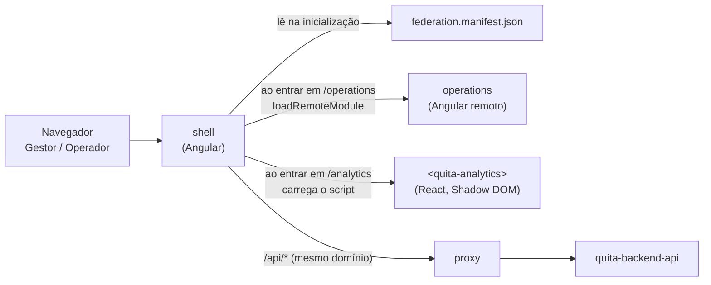

<p align="center">
  
</p>

<p align="center">
  <strong>Capítulo 3 · O balcão da Credora</strong><br />
  O sistema interno em que o Gestor configura e acompanha, e o Operador trabalha a Fila.
</p>

<p align="center">
  
  
  
  
  
</p>

---

## O Quita em uma frase

Uma plataforma B2B de cobrança e renegociação: a **Credora** (uma escola, uma clínica) sobe a lista de quem deve e define até onde aceita negociar; o **Devedor** resolve sozinho pelo celular; o **Operador** cuida só das exceções; o **Gestor** vê quanto recuperou.

## Onde este capítulo entra na história

Antes de a Ana receber o link no celular, alguém na escola fez três coisas aqui: o **Gestor** importou a Carteira com 3.000 Devedores, definiu a Política (até 25% de desconto e 10 parcelas para quem está entre 91 e 180 dias de atraso) e publicou. Quando a Ana não resolve sozinha, a ficha dela aparece na **Fila** de um **Operador**, que liga, registra a Tratativa e negocia dentro da mesma Política. No fim do mês, o Gestor abre o **Painel** e vê quanto recuperou.

| Capítulo | Repositório | Para quem | O que resolve |
| --- | --- | --- | --- |
| 1 · O porquê | [`quita-docs`](https://github.com/quita-app/quita-docs) | Quem quer entender o produto | Problema, regras de negócio, arquitetura e decisões |
| 2 · As regras | [`quita-backend-api`](https://github.com/quita-app/quita-backend-api) | Todos, por trás das telas | Regras, dados e integrações |
| **3 · O balcão da Credora** 📍 | **`quita-backoffice-web`** | Gestor e Operador | Importar, configurar a Política, trabalhar a Fila, acompanhar o Painel (você está aqui) |
| 4 · A porta da Ana | [`quita-debtor-portal-web`](https://github.com/quita-app/quita-debtor-portal-web) | Devedor | Ver a Dívida, simular, fechar o Acordo, pagar por Pix |

## O que este repositório faz

Três aplicações que o usuário enxerga como uma tela só (**micro front-ends**), publicadas separadamente:

| App | O que é | Tecnologia | Porta local |
| --- | --- | --- | --- |
| `shell` | A moldura: login, sessão, menu e quem carrega as outras áreas | Angular | 4200 |
| `operations` | O dia a dia: Fila, ficha do Devedor, importação, Política, pagamentos | Angular, por Native Federation | 4201 |
| `analytics` | O Painel do Gestor | React, como o Web Component `<quita-analytics>` | 4202 (sozinho) / 4302 (no shell) |

## Como funciona



- **Nada é baixado antes da hora:** cada área só chega quando o usuário entra nela.
- **Uma área fora do ar não derruba a moldura:** o miolo mostra "Não foi possível carregar esta área", com **Tentar de novo**.
- **Angular e RxJS são baixados uma vez** e compartilhados entre o shell e o Operações.
- **O React fica isolado** atrás da tag `<quita-analytics>`: propriedades para dentro, eventos para fora, estilo isolado por Shadow DOM.

## Comece em 5 minutos

**Você precisa de:** Node 24 e a [API](https://github.com/quita-app/quita-backend-api) rodando em `localhost:8080`.

```bash
git clone https://github.com/quita-app/quita-backoffice-web.git
cd quita-backoffice-web
npm ci
```

Um terminal por app:

```bash
npx nx serve operations                               # http://localhost:4201
npx nx build analytics && npx nx preview analytics    # http://localhost:4302/quita-analytics.js
npx nx serve shell                                    # http://localhost:4200  ← abra este
```

Em `localhost:4200`, clique em **Operações** e em **Painel**: os dois mostram "API: no ar".

## Comandos do dia a dia

| Para | Comando |
| --- | --- |
| Servir um app | `npx nx serve <shell \| operations \| analytics>` |
| Testes de um projeto | `npx nx test <projeto>` |
| Lint (inclui as fronteiras entre libs) | `npx nx lint <projeto>` |
| Só o que a sua branch afetou | `npx nx affected -t lint test build` |
| Ver o grafo de projetos | `npx nx graph` |

## Estrutura

```
apps/
  shell/          moldura e composição          operations/   remote Angular
  analytics/      Web Component React           shell-e2e/    ponta a ponta (Playwright)
libs/
  shared/         api-types · design-tokens · util      TypeScript puro, sem framework
  angular/        ui · data-access · session · realtime
  operations/     feature-queue · feature-imports · feature-policies · feature-payments · feature-admin
  react/          ui
```

**As fronteiras são verificadas pelo lint.** Cada projeto tem duas tags, o tipo (`feature`, `ui`, `data-access`, `util`) e o escopo (`angular`, `react`, `shared`), e um import que o desenho proíbe (Angular importando React, UI importando HTTP) quebra o `nx lint`.

## Decisões que moldam este repositório

| Decisão | Por quê | ADR |
| --- | --- | --- |
| Monorepo para o backoffice, repos separados para portal e API | Um produto que muda junto; os outros têm público e ciclo próprios | [0001](https://github.com/quita-app/quita-docs/blob/main/docs/adr/0001-repository-structure.md) |
| Micro front-ends por domínio | Áreas publicadas sozinhas, numa moldura só | [0002](https://github.com/quita-app/quita-docs/blob/main/docs/adr/0002-micro-frontend-composition.md) |
| Native Federation + Web Component para o React | Padrões do navegador, builder esbuild do Angular, React sem atravessar a fronteira | [0012](https://github.com/quita-app/quita-docs/blob/main/docs/adr/0012-native-federation-and-web-component.md) |
| Tipos gerados, chamadas escritas à mão | O contrato vem do `openapi.json` da API | [0011](https://github.com/quita-app/quita-docs/blob/main/docs/adr/0011-generated-types-handwritten-calls.md) |

## Status

- [ ] **F01 · Walking skeleton:** workspace, fronteiras, tokens, federação, Web Component, deploy na Vercel.
- [ ] **F02 · Acesso ao backoffice:** login, sessão, moldura final.
- [ ] **F03 em diante:** Credoras, importação, Busca, Política, Fila, Painel…

## Leia também

- [Glossário](https://github.com/quita-app/quita-docs/blob/main/GLOSSARY.md): o vocabulário do domínio.
- [LLD do backoffice](https://github.com/quita-app/quita-docs/blob/main/docs/lld/backoffice.md): estrutura, rotas, estado e comunicação entre shell e remotes.
- [Design system](https://github.com/quita-app/quita-docs/blob/main/design/DESIGN.md): cores, tipografia e componentes.

<p align="center"><sub>Quita · cobrança que baixa a tensão</sub></p>
