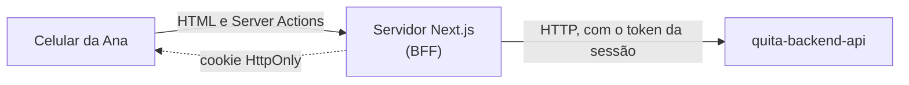

<p align="center">
  
</p>

<p align="center">
  <strong>Capítulo 4 · A porta da Ana</strong><br />
  O site em que o Devedor resolve a dívida sozinho, pelo celular, em menos de 3 minutos.
</p>

<p align="center">
  
  
  
  
  
</p>

---

## O Quita em uma frase

Uma plataforma B2B de cobrança e renegociação: a **Credora** (uma escola, uma clínica) sobe a lista de quem deve e define até onde aceita negociar; o **Devedor** resolve sozinho pelo celular; o **Operador** cuida só das exceções; o **Gestor** vê quanto recuperou.

## Onde este capítulo entra na história

São 22h e a Ana recebe um SMS da escola. Ela deve R$ 1.000,00 de mensalidade, vencida há 120 dias. Abre o link, informa o CPF e o código de 6 dígitos, vê quanto deve **e por quê**, arrasta o simulador até 5 parcelas, revisa o Acordo e paga a entrada por Pix. Ninguém ligou para ela, e ela não precisou ligar para ninguém.

Este portal é a parte do Quita que o Devedor vê. Ele foi desenhado para **baixar a tensão**: uma decisão por tela, números grandes, linguagem sem ameaça e o verde-menta guardado para o momento em que a dívida fica em dia.

| Capítulo | Repositório | Para quem | O que resolve |
| --- | --- | --- | --- |
| 1 · O porquê | [`quita-docs`](https://github.com/quita-app/quita-docs) | Quem quer entender o produto | Problema, regras de negócio, arquitetura e decisões |
| 2 · As regras | [`quita-backend-api`](https://github.com/quita-app/quita-backend-api) | Todos, por trás das telas | Regras, dados e integrações |
| 3 · O balcão da Credora | [`quita-backoffice-web`](https://github.com/quita-app/quita-backoffice-web) | Gestor e Operador | Importar, configurar a Política, trabalhar a Fila, acompanhar o Painel |
| **4 · A porta da Ana** 📍 | **`quita-debtor-portal-web`** | Devedor | Ver a Dívida, simular, fechar o Acordo, pagar por Pix (você está aqui) |

## O que este repositório faz

- **Acesso sem senha:** CPF + código de uso único, sem revelar se a pessoa deve ou não.
- **Dívidas explicadas:** valor original, valor atualizado e o que compõe a diferença.
- **Simulador:** de 1x a 10x, com o desconto da Política da Credora calculado pela API.
- **Acordo e Pix:** revisão, confirmação e o código Pix da entrada, com a confirmação do pagamento na tela.
- **A marca da Credora:** o portal fala em nome da escola, não do Quita.

## Como funciona

O portal tem duas metades no mesmo app Next.js: as **telas** e um **BFF** (*Backend for Frontend*). **O navegador nunca fala com a API**: fala com o servidor do Next, que fala com a API.



- O endereço da API e os tokens só existem no servidor (nenhuma variável `NEXT_PUBLIC_*`).
- Todo acesso à API passa por `src/lib/api/`, protegido por `server-only`: importar isso no navegador quebra o build.
- Com a API dormindo (plano gratuito), a página responde em até 5 s com "acordando", nunca com erro.

## Comece em 5 minutos

**Você precisa de:** Node 24 e a [API](https://github.com/quita-app/quita-backend-api) rodando em `localhost:8080`.

```bash
git clone https://github.com/quita-app/quita-debtor-portal-web.git
cd quita-debtor-portal-web
npm ci
cp .env.example .env.local     # API_INTERNAL_URL=http://localhost:8080
npm run dev                    # http://localhost:3000
```

A página inicial mostra "API: no ar".

## Comandos do dia a dia

| Para | Comando |
| --- | --- |
| Servidor de desenvolvimento | `npm run dev` |
| Lint | `npm run lint` |
| Tipos | `npx tsc --noEmit` |
| Testes | `npm test` |
| Build | `npm run build` |

## Configuração

| Variável | Para quê |
| --- | --- |
| `API_INTERNAL_URL` | Endereço da API, usado só no servidor |
| `REVALIDATE_SECRET` | Assinatura da revalidação sob demanda (Fase 2) |

Documentadas em [`.env.example`](.env.example). O `.env.local` nunca é versionado.

## Estrutura

```
src/
  app/
    page.tsx                 página do Quita
    c/[slug]/                o portal de cada Credora (marca, acesso, Dívidas, Acordos)
    bff/                     leituras interativas do navegador (simulador, status do Pix)
  lib/api/                   único ponto de contato com a API (server-only)
  lib/schemas/               validação com Zod, a mesma no cliente e no servidor
  components/                componentes de tela
```

## Decisões que moldam este repositório

| Decisão | Por quê | ADR |
| --- | --- | --- |
| Repositório próprio, fora do monorepo | Público, ciclo e requisitos (SEO, celular, acessibilidade) diferentes do backoffice | [0001](https://github.com/quita-app/quita-docs/blob/main/docs/adr/0001-repository-structure.md) |
| Autenticação própria do Devedor, sem senha | Código de uso único, protegido contra enumeração | [0004](https://github.com/quita-app/quita-docs/blob/main/docs/adr/0004-own-authentication.md) |
| Credora no caminho (`/c/escola-x`), não em subdomínio | Um domínio e um certificado no plano gratuito | [0013](https://github.com/quita-app/quita-docs/blob/main/docs/adr/0013-creditor-path-instead-of-subdomain.md) |

## Status

- [ ] **F01 · Walking skeleton:** página de health pelo servidor, `server-only`, tokens, deploy na Vercel.
- [ ] **F07 · Acesso do Devedor:** CPF + código.
- [ ] **F08 a F10:** Dívidas, simulador, Acordo e Pix: o fluxo completo da Ana.

## Leia também

- [Glossário](https://github.com/quita-app/quita-docs/blob/main/GLOSSARY.md): o vocabulário do domínio.
- [LLD do portal](https://github.com/quita-app/quita-docs/blob/main/docs/lld/portal.md): rotas, renderização, sessão e cache.
- [Design system](https://github.com/quita-app/quita-docs/blob/main/design/DESIGN.md) e [textos de tela](https://github.com/quita-app/quita-docs/blob/main/design/ux-writing.md).

<p align="center"><sub>Quita · cobrança que baixa a tensão</sub></p>
